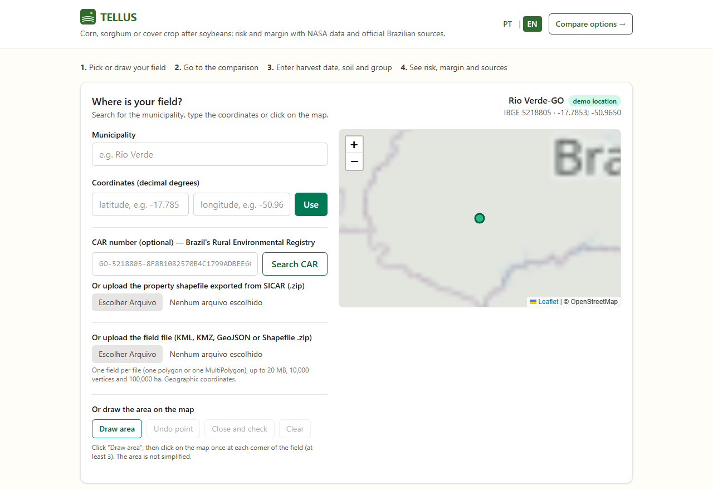
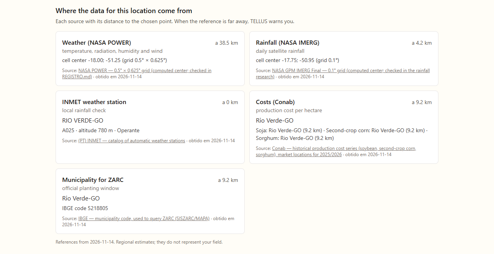
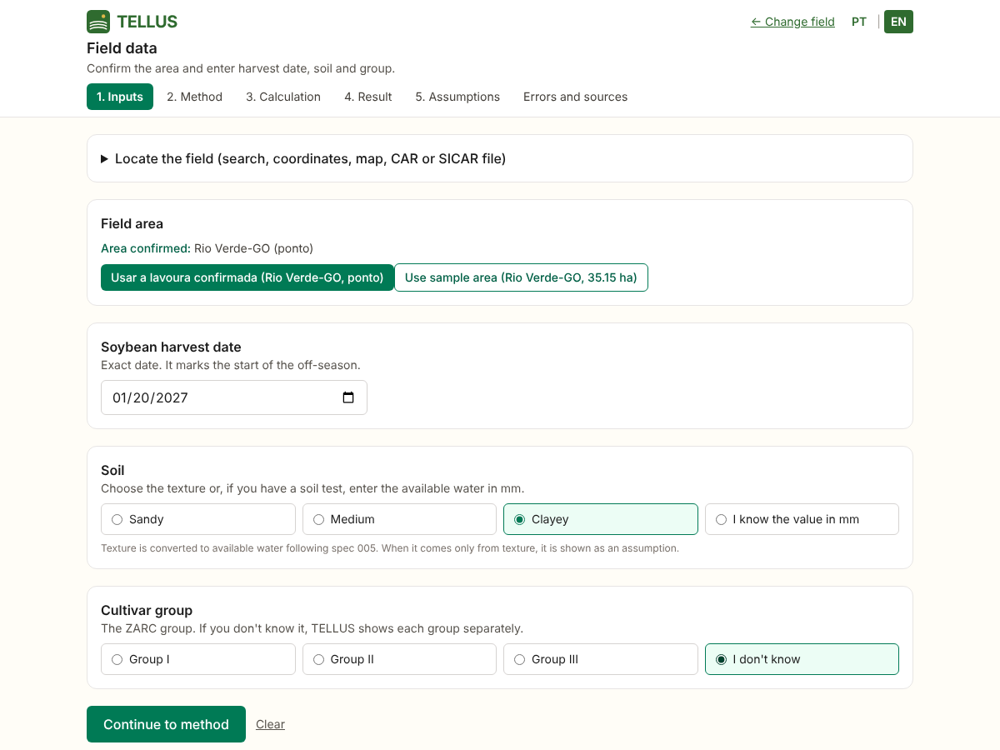
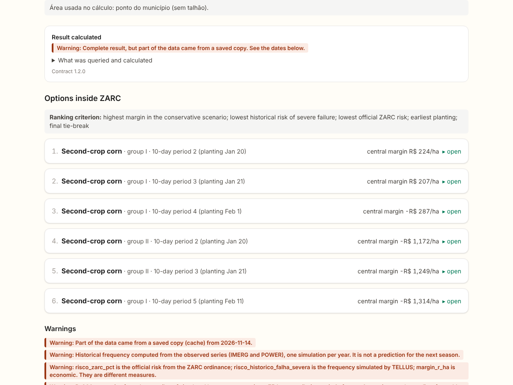
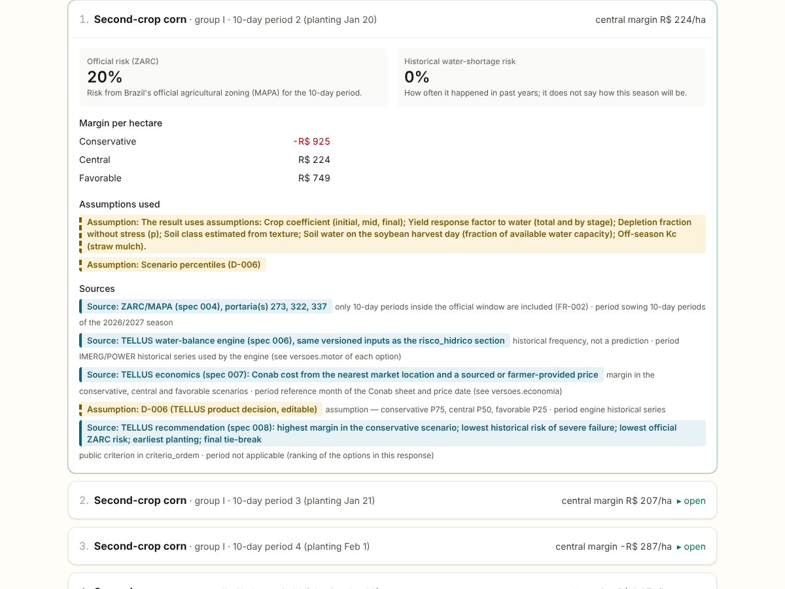
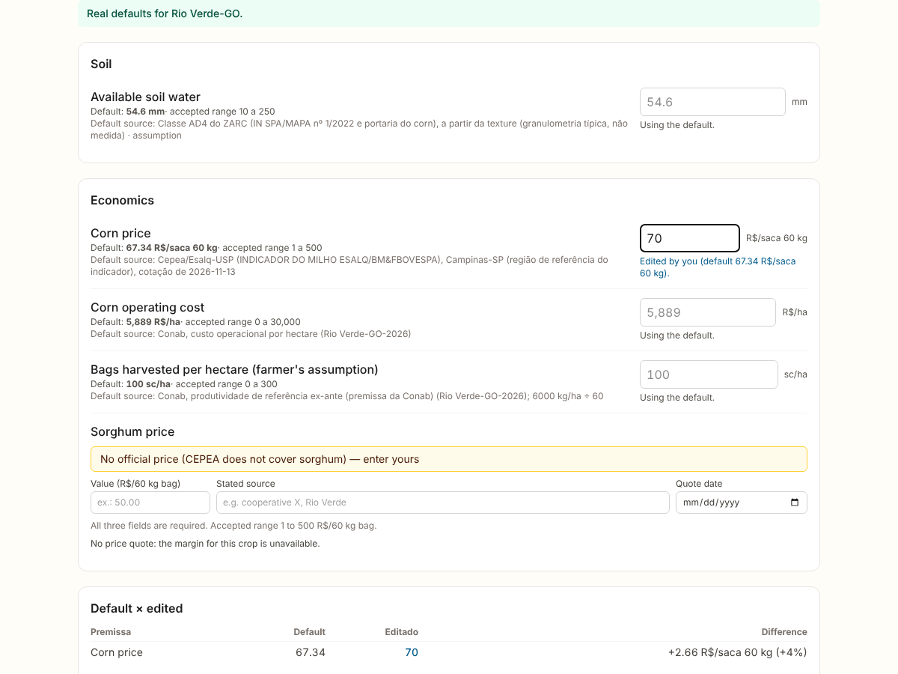
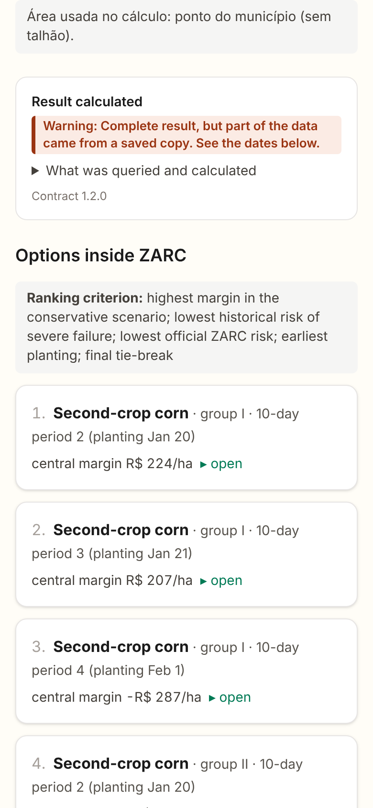
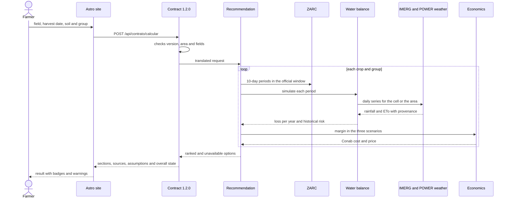

<div align="center">


**Decision support for the second crop season with NASA data and official sources.**

**English** · [Português](README.pt-BR.md)


[Gallery](#-gallery) · [How it was built](#-how-it-was-built) · [Features](#-features) · [Why the name?](#-why-the-name) · [Architecture](#-architecture) · [Running](#-running) · [Structure](#-structure) · [Limitations](#-limitations-and-next-steps) · [Context](#-context)

</div>

---

> [!NOTE]
> A project by a team of three, built for the **NASA Space Apps Challenge 2026**, *Field Shift* challenge. It runs
> locally, with no hosting, and the reference case is Rio Verde, in the state of Goiás, Brazil. The output is historical
> frequency and margin per scenario; **it is not a crop forecast**.

Every year, between January and March, soybean farmers in the Brazilian Cerrado have to decide what to plant after the
harvest: second-crop corn, sorghum or a cover crop. The answer depends on the day the soybeans leave the field, how much
water the soil holds, the official planting window and the cost of each crop. All of that information exists, but it
is scattered across NASA satellites, ordinances from Brazil's Ministry of Agriculture (MAPA), spreadsheets from Conab
(the national supply company) and price indicators from Cepea.

TELLUS brings those sources into a single flow. The farmer marks the field on the map, by its CAR number (Brazil's Rural
Environmental Registry) or by uploading a file, enters the harvest date, the soil and the cultivar group, and gets the
options that fall inside the official agricultural climate risk zoning (ZARC). They come ranked by a public criterion,
with the official risk, the historical water-shortage risk simulated over 25 years of satellite rainfall, and the margin
per hectare in three scenarios. Every number in the response carries its source, its period and whether it is official
data, an assumption or a value the farmer entered, and any assumption can be edited to see how it changes the result.

## 📸 Gallery

<table align="center">
  <tr>
    <td align="center"><br><sub><b>Where is your field?</b><br><code>/?lang=en</code></sub></td>
    <td align="center"><br><sub><b>Where the data come from</b><br><code>/?lang=en</code></sub></td>
  </tr>
  <tr>
    <td align="center"><br><sub><b>Reference case inputs</b><br><code>/comparacao/entradas</code></sub></td>
    <td align="center"><br><sub><b>Options inside ZARC</b><br><code>/comparacao/resultado</code></sub></td>
  </tr>
  <tr>
    <td align="center"><br><sub><b>Risk, margin and provenance</b><br><code>/comparacao/resultado</code></sub></td>
    <td align="center"><br><sub><b>Editable assumptions</b><br><code>/comparacao/premissas</code></sub></td>
  </tr>
</table>

<p align="center"><br><sub><b>Result on a phone (390 × 844)</b></sub></p>

<p align="center"><sub>Real captures of the English version of the site running against the local API, with the series versioned in
the repository. The first two come from the team's e2e suite (Edge, commit <code>a4719cc</code>); the others were
taken with Chrome on commit <code>ccd4590</code>, in an environment without access to OpenStreetMap tiles. The few
Portuguese strings still visible are real translation gaps, listed under <a href="#-limitations-and-next-steps">Limitations</a>.</sub></p>

## 🧭 How it was built

### 1. What the challenge asked for

*Field Shift* asks for a crop rotation decision support tool that uses NASA data, local soil, crop characteristics and
the farmer's priorities. Before writing any code, the team turned that into concrete acceptance criteria:

- the recommendation may only contain options inside the official ZARC planting window;
- official risk, historical risk and margin are shown separately, because they measure different things;
- every number shows its source, version, period, unit, location and quality, and nothing is presented as a forecast;
- a parameter without a source is a declared, editable assumption, never a hidden value;
- the flow works on desktop and on phones, in Portuguese and in English.

### 2. What we analyzed

The first question was which rainfall to use, since the whole water balance depends on it. NASA POWER rainfall for Rio
Verde dropped from a median of 1,353 mm/year (1984 to 2024) to 678 mm in 2025, and the suspicion was a product bias
rather than a real drought. To check it, the series was compared day by day with the INMET automatic weather station
A025 (INMET is Brazil's national meteorological institute), 0 km from the town, on the same valid dates.

<details>
<summary><b>Rainfall sources evaluated (January to June, 1,218 paired days over seven years)</b></summary>

| Source | Bias against A025 | MAE (mm/day) | RMSE (mm/day) | Outcome |
|---|---|---|---|---|
| NASA GPM IMERG Final V07B (0.1°) | −1.03% | 4.13 | 8.59 | adopted as the main source |
| NASA POWER `PRECTOTCORR` (0.5° × 0.625°) | −26.96% | 4.53 | 9.85 | rejected for rainfall |
| POWER corrected per month with the station | bias from −49.62% to −46.65% in evaluation | 4.87 to 4.93 | | rejected: the correction made MAE worse |
| ERA5 (Open-Meteo) | also low in recent years | | | cannot act as referee and is not NASA |

The aggregate IMERG bias hides yearly differences (+25.64% in 2012, −19.50% in 2025), which is why the app shows the
local validation next to the result. Scripts, charts and full numbers are in
[`docs/pesquisa_chuva/RELATORIO.md`](docs/pesquisa_chuva/RELATORIO.md) (in Portuguese).

</details>

The other sources were also tested with real data before entering the plan: Conab costs per market location, ZARC
windows from SISZARC (which answers a plain POST, with no login), CAR properties through the SICAR WFS service, MODIS
NDVI and SMAP soil moisture. Each test's result, with its date and blockers, is in the research file of the matching spec under [`specs/`](specs/).

### 3. What we decided

Rainfall comes from IMERG Final, the INMET station is the local validation, and POWER provides temperature, radiation,
humidity and wind, which feed evapotranspiration. The agronomic scope is the second crop after soybeans, with
nationwide coverage and Rio Verde as the validated reference case. No deficit, yield or margin is computed without a
verifiable model: the water balance follows FAO-56, windows and available water come from the ZARC ordinances, costs
from Conab and the corn price from Cepea, and whatever has no source (sorghum Kc, loss scenarios) appears as an
assumption together with the decision that created it (D-001 to D-011).

Work was organized as specifications with GitHub Spec Kit: 14 specs, each with a plan, tasks, a checklist and issues,
merged into `main` through pull requests. Product decisions (D-001 to D-011) are in
[`docs/sdd/DUVIDAS_ETAPA1.md`](docs/sdd/DUVIDAS_ETAPA1.md) and the project principles in
[`docs/CONSTITUICAO.md`](docs/CONSTITUICAO.md) (both in Portuguese).

### 4. How we implemented it

| Step | Spec / module | What was done | Resource used |
|---|---|---|---|
| a | 002 `tellus.localizacao` | Municipality, coordinates and the cell of each source (POWER, IMERG, INMET station, Conab location) with its distance | IBGE (5,571 municipalities), INMET catalog |
| b | 001 and 002 `tellus.car`, `tellus.lavoura` | Field by CAR number, SICAR shapefile, KML, KMZ, GeoJSON or drawing on the map; validation and confirmation | SICAR WFS, `pyshp`, plain Leaflet |
| c | 003 `tellus.clima` | IMERG client over DAP4 and POWER client, per-cell cache, rainfall weighted by the field area | Earthdata OPeNDAP, `h5py` |
| d | 004 `tellus.zarc` | 2026/27 planting windows for all 27 states (5,569 municipalities with at least one zoned crop) | SISZARC/MAPA |
| e | 005 `tellus.culturas` | Classes AD1 to AD6, available water from soil texture and parameters flagged as sourced or assumed | IN SPA/MAPA nº 1/2022, ordinances |
| f | 006 `tellus.motor` | Penman-Monteith ETo and daily water balance including the off-season, simulated on the same date each year | FAO-56 and FAO-33 |
| g | 007 `tellus.economia` | Conab cost for the location, Cepea or farmer-provided price, margin in the conservative, central and favorable scenarios | Conab sheets, Cepea indicator |
| h | 008 `tellus.recomendacao` | Evaluation by 10-day period and group, public ranking and parity between single-crop and full comparison | |
| i | 009 and 010 | MODIS NDVI and SMAP moisture as regional context, isolated from the calculation | ORNL DAAC, NSIDC |
| j | 011 `tellus.contrato` | Versioned contract (1.2.0) with provenance on every number and a single error envelope | FastAPI, Pydantic |
| k | 012 to 014 `frontend/` | Eight-page interface, visual identity with AA contrast and the English version | Astro 7, Tailwind 4 |

Some details are not obvious. The SICAR server only negotiates ciphers that OpenSSL 3.5 rejects by default, so the
client uses `DEFAULT:@SECLEVEL=1` while still verifying the certificate. The official SISZARC report labels the
column for 10-day period 35 as "Dev 35" and spells several municipalities differently from IBGE (in São Paulo it even
stores "Conceic?o"), and each mismatch was resolved by an alias checked against the IBGE counts. The official
available-water equation is not monotonic in clay content, so texture alone only yields an assumption. The calculation
request carries the geometry of the confirmed field, not just the municipality point, and the result states which area
went into the calculation (a 142.89 ha plot, or "municipality point, no plot"); that fix came in commit `97cdc1c` with
its own test (`pedido-area.test.ts`). Finally, one test walks the import tree to make sure no calculation module
imports SMAP moisture, and another runs the real recommendation with and without SMAP and requires an identical result.

### 5. How we verified it

With the API running, this loop sends the contract's six example requests to the calculation route and checks the
HTTP code and state of each response:

```bash
cd specs/011-contrato-api/contracts/exemplos
for f in pedido_*.json; do
  python3 -c "import json; d=json.load(open('$f')); print(json.dumps(d.get('pedido', d)))" \
  | curl -s -o /tmp/r.json -w "$f | %{http_code} | " -X POST -H 'Content-Type: application/json' \
      --data-binary @- http://localhost:8000/api/contrato/calcular
  python3 -c "
import json; d = json.load(open('/tmp/r.json')); e = d.get('erro')
if e: print(e['codigo'])
else:
    r = d['recomendacao']['conteudo']; a = r['alternativas'][0]
    print(d['estado_geral'], '|', len(r['alternativas']), 'alternativas, 1a:', a['cultura'], a['grupo'], 'decendio', a['decendio'])"
done
```

| Request | HTTP | Response |
|---|---|---|
| `pedido_valido.json` (Rio Verde, harvest 01/20/2027, clayey soil, group I, sorghum at R$ 55/bag entered by the farmer) | 200 | `incompleto`, 12 options, first: grain sorghum, group I, 10-day period 2 |
| `pedido_area_nao_confirmada.json` | 422 | `pedido_invalido` |
| `pedido_geometria_invalida.json` (self-intersecting polygon) | 422 | `geometria_invalida` |
| `pedido_sem_solo.json` | 422 | `pedido_invalido` |
| `pedido_versao_ausente.json` | 422 | `versao_ausente` |
| `pedido_versao_incompativel.json` | 422 | `versao_incompativel` |

The `incompleto` (incomplete) state of the valid request is expected: brachiaria has no Conab cost and none was
entered in the request, so its economics section is unavailable, and the contract rule does not let a partial result
pass as final. The other checks, run on commit `ccd4590`:

| Check | Result |
|---|---|
| `uv run pytest` (backend) | 483 passed, 1 skipped, in 69.6 s |
| `npm test` (vitest, frontend) | 184 of 184 in 10 files |
| Reference case flow in the browser, in English (group "I don't know") | result calculated on desktop and phone, 6 options, with the area used shown at the top |
| Team e2e suite with Playwright ([report](docs/testes-e2e/RELATORIO.md)) | 21 of 21 tests, 131 of 131 checks, 45 captures (commit `a4719cc`, Edge) |
| Script-guided usability test ([report](docs/teste-usabilidade/RELATORIO.md)) | 45 of 45 items, with a video of each session |
| IMERG rainfall against station A025 | bias −1.03%, MAE 4.13 mm/day over 1,218 paired days |

Going back to the criteria in step 1: the option list only receives 10-day periods inside the ZARC window, the result
keeps official risk, historical risk and margin apart, every source and assumption has its own badge (and the contract
test walks more than 1,000 numbers in the Rio Verde case without finding one lacking provenance), edited assumptions
reach the backend and come back next to their defaults, and the flow was checked at 390 × 844 and in English.

## ✨ Features

| | What it does |
|---|---|
| **Field location** | Municipality search, coordinates, click on the map, CAR number, SICAR shapefile, KML, KMZ, GeoJSON or a drawn polygon. The area is validated and confirmed before any calculation. |
| **Sources for the location** | Shows the POWER and IMERG cells and the nearest INMET station and Conab location, with the distance to each, and warns when the reference is far away. |
| **Two methods** | Chosen crop (best periods for it) or full comparison (which crop and which period), with tested parity between both. |
| **Risk as two measures** | Official ZARC risk per 10-day period and historical frequency of severe failure simulated by the water balance, side by side and never added up. |
| **Margin in three scenarios** | Conservative, central and favorable from the quartiles of simulated loss (P75, P50, P25), with Conab cost and a Cepea or farmer-provided price. |
| **Editable assumptions** | Available water, corn price, cost and yield, and a sorghum quote with its origin and date; the result shows the default and the new value. |
| **Provenance** | Source, assumption, warning and error badges with text and icon, never color alone; a list of what was queried, with the date of any saved copy. |
| **Works offline** | Real Rio Verde series versioned with sha256: without an Earthdata token, the whole demo runs from them. |
| **Regional context** | MODIS NDVI and SMAP moisture shown as context, isolated from the calculation. |
| **Portuguese and English** | PT \| EN switch at the top and `?lang=en`; the same request in both languages returns identical numbers, ranking and hash. |

## 🌾 Why the name?


*Tellus*, also called *Tellus Mater* or *Terra Mater*, was the Roman goddess of the earth, the mother who makes the soil
bear fruit. She is a very old deity, older than the Empire, and was later identified with the Greek Gaia. Her temple
stood on the Esquiline Hill in Rome and came from a vow by the general Publius Sempronius Sophus, who promised it to the
goddess in 268 BC when an earthquake shook the battlefield during the war against the Picentes.

The Romans honored her in festivals tied to fertility and good harvests. The one closest to this project is the
*Sementivae*, the sowing festival: on a day in late January, set each year by the pontiffs, Tellus and Ceres received
offerings as "mothers of the crops", so that the grain sown in the earth would take root. That is exactly when farmers
in the Cerrado harvest their soybeans and decide what to sow next, and the TELLUS reference case has its harvest on
January 20.

The name is also an acronym: **T**errestrial **E**nvironmental **L**earning & **L**and **U**tilization **S**ystem, a
system that learns from environmental data about the Earth, seen from space by NASA satellites, to guide the use of
farmland.

## 🧱 Architecture

The frontend is static (Astro) and talks to a FastAPI backend through the versioned contract. The API computes nothing
on its own: the contract calls the recommendation, which evaluates each crop and group inside the ZARC windows using the
water-balance engine (which pulls the weather series) and the economics module, and then wraps everything with
provenance.



The water balance is a pure one-day function, applied in sequence from the soybean harvest to the end of the cycle
(code comments are in Portuguese, as in the repository):

```python
# backend/src/tellus/motor/balanco.py
def passo(dr: float, chuva: float, eto: float, kc: float, cad: float, p: float) -> tuple[float, float, float, float]:
    """Um dia de balanço. Devolve (dr_novo, etc, eta, drenagem)."""
    etc = kc * eto
    raw = p * cad
    ks = 1.0 if dr <= raw else max(0.0, (cad - dr) / ((1 - p) * cad))
    eta = ks * etc
    dr_novo = dr - chuva + eta
    drenagem = 0.0
    if dr_novo < 0:
        drenagem = -dr_novo
        dr_novo = 0.0
    if dr_novo > cad:  # não seca além do ponto de murcha: ETa limitada
        eta -= dr_novo - cad
        dr_novo = cad
    return dr_novo, etc, eta, drenagem
```

The ranking is public and travels in the response itself, so the farmer can see why one option came ahead of another:

```python
# backend/src/tellus/recomendacao/servico.py
def _chave(a: dict) -> tuple:
    return (-a["margem_r_ha"]["conservador"], a["risco_historico_falha_severa"], a["risco_zarc_pct"] or 0, a["decendio"], a["cultura"], a["grupo"])
```

And the overall state never calls a result final when a required section is missing:

```python
# backend/src/tellus/contrato/regras.py
def estado_geral(secoes: Iterable[Mapping], fontes: Iterable[Mapping]) -> str:
    """erro > incompleto > final_com_cache > final. Parcial nunca é final."""
    obr = [s for s in secoes if s["obrigatoria"]]
    if any(s["estado"] == "erro" for s in obr):
        return "erro"
    if any(s["estado"] in ("pendente", "indisponivel") for s in obr):
        return "incompleto"
    if any(f["estado"] == "cache" for f in fontes):
        return "final_com_cache"
    return "final"
```

The API exposes 37 routes over 33 paths (`/api/localizacao`, `/api/car`, `/api/lavoura`, `/api/clima`, `/api/zarc`,
`/api/culturas`, `/api/motor`, `/api/economia`, `/api/recomendacao`, `/api/vegetacao`, `/api/umidade` and
`/api/contrato`), documented at `http://localhost:8000/docs` while the API is running.

## 📦 Running

Requirements: Python 3.12+ with [uv](https://docs.astral.sh/uv/) and Node 22.23.4+ (the version required in
`frontend/package.json`).

```bash
git clone https://github.com/Pedrojscx/TELLUS.git
cd TELLUS

# API (port 8000)
cd backend
uv sync
uv run uvicorn tellus.api.app:app --port 8000

# Site (port 4321), in another terminal
cd frontend
npm ci
npm run dev
```

Open `http://localhost:4321/?lang=en`, search for "Rio Verde", go to the comparison and use harvest on 01/20/2027,
clayey soil and group "I don't know" to reproduce the reference case.

```bash
cd backend && uv run pytest          # 483 backend tests
cd frontend && npm test              # 184 frontend tests
cd frontend && npm run test:e2e      # e2e suite (uses the installed Microsoft Edge)
```

> [!TIP]
> Without the `EARTHDATA_TOKEN` variable, the app uses the real series versioned in `referencias/` and works offline
> for Rio Verde. To download IMERG for another cell, create a token on Earthdata, authorize the "NASA GESDISC DATA
> ARCHIVE" application in your profile and put the token in a `.env` file at the repository root (ignored by Git). To
> open the site on a phone on the same network, use the computer's IP on port 4321: the site calls the API on the same
> machine, on port 8000.

## 📁 Structure

```text
TELLUS/
├── backend/
│   ├── src/tellus/              # API package (6,961 lines)
│   │   ├── api/                 # FastAPI routes and app.py
│   │   ├── localizacao/ car/ lavoura/
│   │   ├── clima/               # IMERG, POWER and area-weighted rainfall
│   │   ├── zarc/ culturas/      # official windows, soil and parameters
│   │   ├── motor/               # ETo and water balance (FAO-56)
│   │   ├── economia/ recomendacao/
│   │   ├── vegetacao/ umidade/  # MODIS and SMAP context, outside the calculation
│   │   ├── contrato/            # versioned contract and limits
│   │   └── i18n/                # Portuguese and English messages
│   └── tests/                   # 483 pytest tests (4,399 lines)
├── frontend/
│   ├── src/pages/               # home page and 7 comparison pages
│   ├── src/components/ lib/     # location picker, result, contract, i18n
│   └── e2e/                     # Playwright suite and usability test
├── referencias/                 # derived series and tables, versioned with sha256
├── scripts/                     # 19 preparation and rainfall research scripts
├── specs/                       # 14 Spec Kit specs (001 to 014)
├── docs/
│   ├── pesquisa_chuva/          # IMERG × POWER × INMET report and charts
│   ├── testes-e2e/              # report, captures and API evidence
│   ├── teste-usabilidade/       # report and session videos
│   ├── marca/                   # brand guide and icon
│   ├── sdd/                     # spec map, decisions and reference base
│   ├── screenshots/ assets/     # images for both READMEs
│   └── CONSTITUICAO.md          # project principles
├── data/                        # raw data kept out of Git, only provenance tracked
├── README.md                    # this file (English, default)
├── README.pt-BR.md              # Portuguese README
└── LICENSE
```

Code, specs and project documents are written in Portuguese; the site and the API messages are available in both
languages.

## 🔭 Limitations and next steps

- **`httpx` is only a development dependency**, but six modules import it at runtime. An install with
  `uv sync --no-dev` comes up without it and the API fails on import. Fix: move `httpx` to `dependencies` in
  `backend/pyproject.toml`.
- **Municipality point chosen without the farmer asking.** When `/` or `/comparacao/entradas` opens with no confirmed
  field, the location picker saves the municipality's default point as the field, and the calculation may run on a
  place the farmer did not choose. The page warns "municipality point (no plot)", but the right behavior is to save
  nothing until the farmer locates the area, or to show the default only as a suggestion.
- **English version has gaps.** The line stating the area used in the calculation (added in `97cdc1c`), the "use the
  confirmed field" button, a few table headers and parts of the source descriptions still appear in Portuguese, and in
  one source text a word replacement leaves "portaria do corn". The fix is to move those strings into the i18n catalog
  and add them to the e2e language test.
- **No test with real farmers.** The usability test followed the team's script with an agent acting as a person; the
  SC-001 criterion in spec 012 asks for five participants. Next step: sessions with farmers or agronomists in Rio Verde.
- **Limited local validation.** Only A025 (Rio Verde) and A026 (Mineiros) have rainfall validation, and the versioned
  IMERG series ends on 2025-09-30, the last month published in the catalog queried. Other regions need a token and
  about 20 minutes of download per cell.
- **Parameters as assumptions.** Kc and Ky follow FAO only as a method, sorghum stages and all of brachiaria have no
  regional source, and the scenario percentiles are a product decision (D-006). All of them are flagged and editable;
  the path forward is calibrating with Embrapa trial data.
- **Sorghum price and cover crop cost.** There is no Cepea sorghum indicator and no Conab sheet for cover crops, so
  both depend on values entered by the farmer.
- **O(n²) polygon validation.** With 20,000 vertices it took 43.8 s; the current limit of 10,000 vertices fits the 60 s
  of decision D-009. A spatial index would handle larger areas.
- **No hosting.** The app runs locally; publishing it requires a server for the API and a cache for the series.

## 🎓 Context

| | |
|---|---|
| Event | NASA Space Apps Challenge 2026 |
| Challenge | *Field Shift* (crop rotation with NASA data) |
| Team | Pedro Lucas Matias (developer), Lucas Krauss (developer) and Egon Henrique (environmental engineer) |
| Period | November 14 and 15, 2026 |
| NASA data | GPM IMERG Final V07B, POWER, MODIS MOD13Q1, SMAP SPL3SMP_E, HLS (optional) |
| Official sources | ZARC/MAPA, Conab, Cepea/Esalq, INMET, IBGE, CAR/SICAR |
| License | [MIT](LICENSE) |

The data and names of NASA, MAPA, Conab, Cepea, INMET and IBGE belong to their respective institutions; TELLUS only
queries them and cites the origin of every number.

---

<div align="center">
<sub>TELLUS · Pedro Lucas Matias · Lucas Krauss · Egon Henrique · 2026</sub>
</div>
