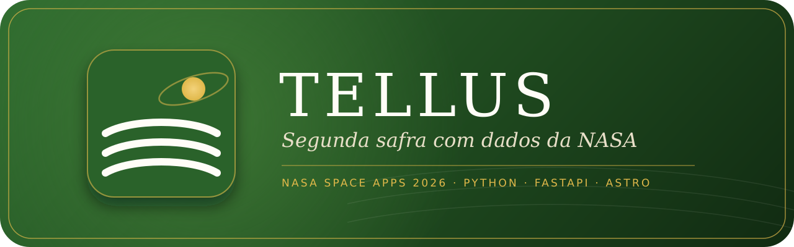
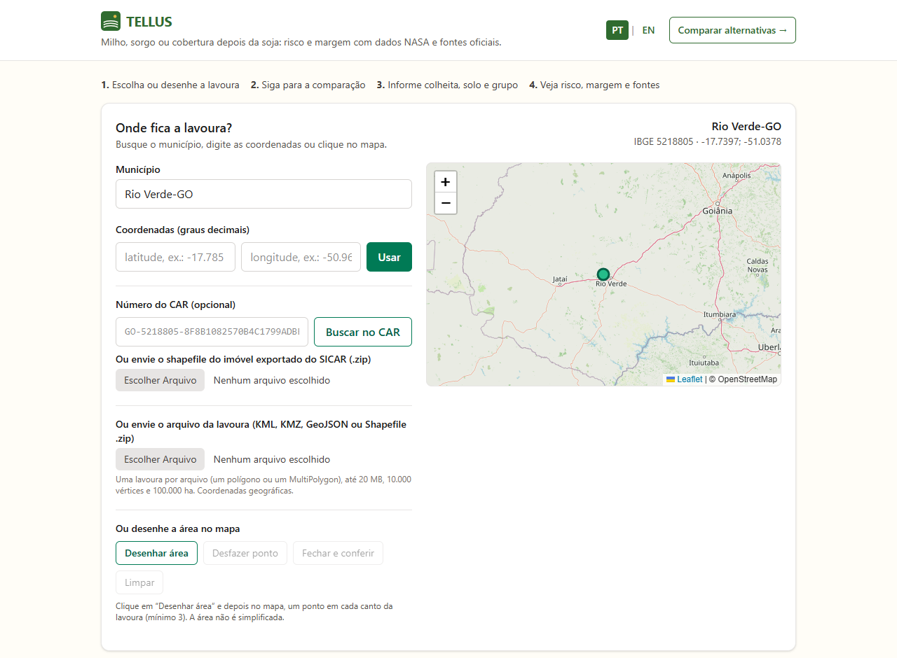
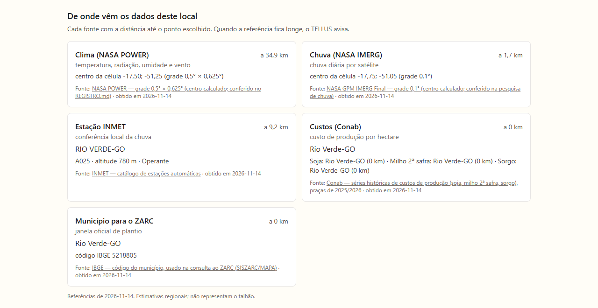
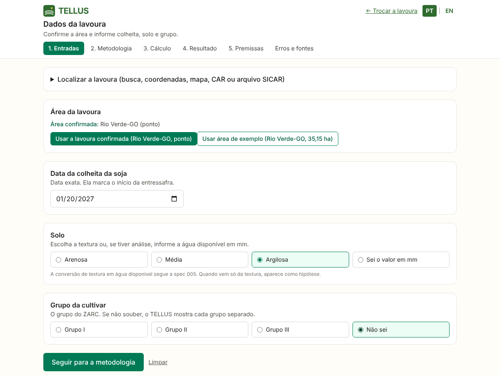
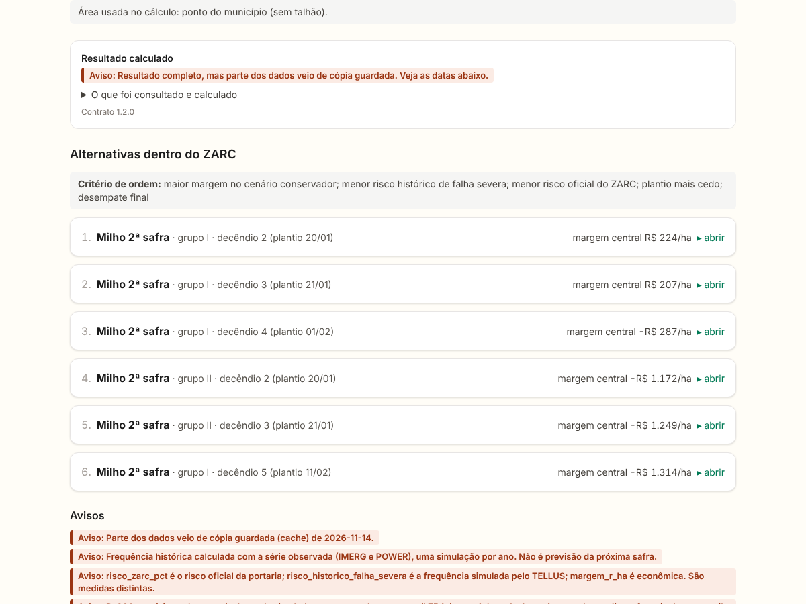
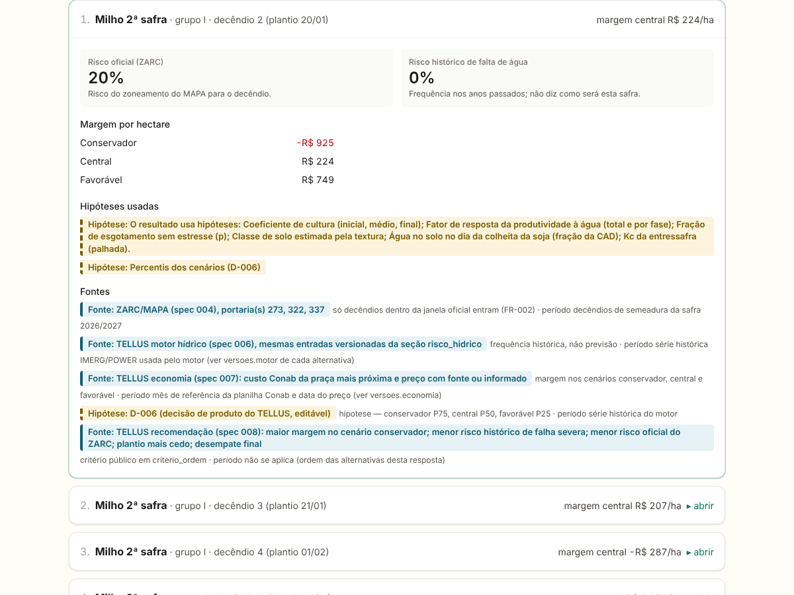
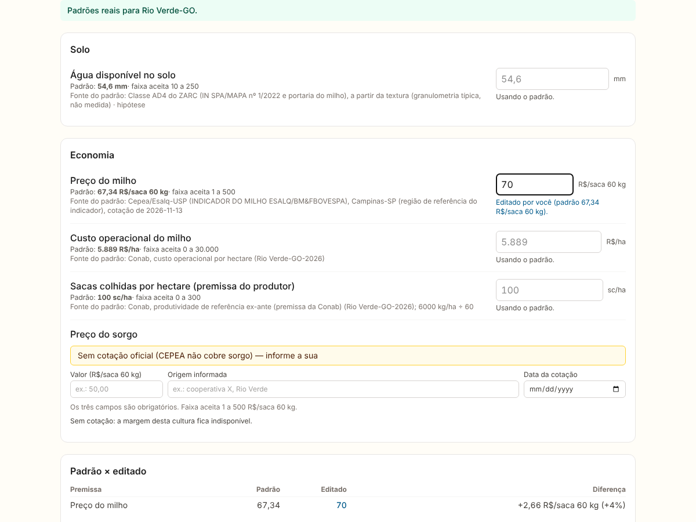
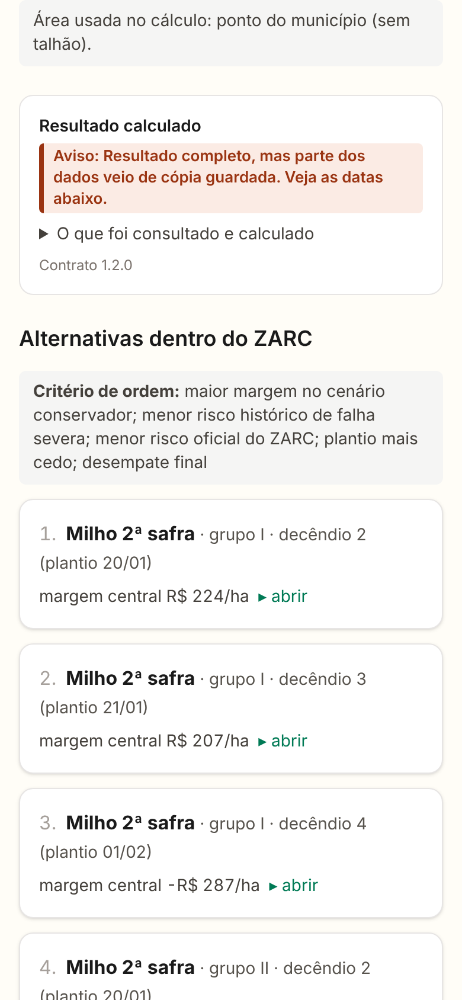
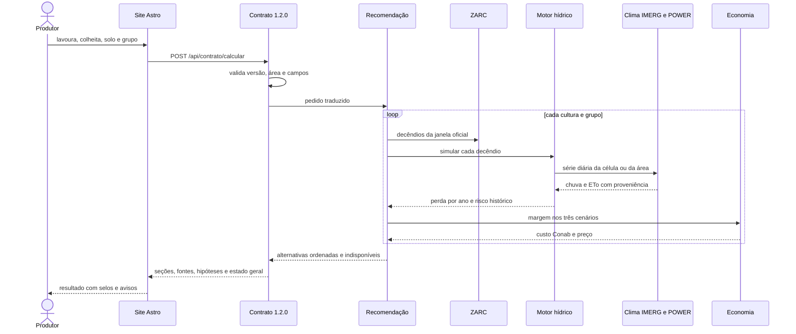

<div align="center">



**Apoio à decisão da segunda safra com dados da NASA e fontes oficiais.**

**Português** · [English](README.en.md)


[Galeria](#-galeria) · [Como foi feito](#-como-foi-feito) · [Funcionalidades](#-funcionalidades) · [Por que o nome?](#-por-que-o-nome) · [Arquitetura](#-arquitetura) · [Executar](#-executar) · [Estrutura](#-estrutura) · [Limitações](#-limitações-e-próximos-passos) · [Contexto](#-contexto)

</div>

---

> [!NOTE]
> Projeto de uma equipe de três pessoas feito para o **NASA Space Apps Challenge 2026**, desafio *Field Shift*. Roda
> localmente, sem hospedagem, e o caso de referência é Rio Verde-GO. O resultado é frequência histórica e margem por
> cenário, **não é previsão de safra**.

Todo ano, entre janeiro e março, o produtor de soja do Cerrado precisa decidir o que plantar depois da colheita:
milho de segunda safra, sorgo ou uma planta de cobertura. A resposta depende da data em que a soja sai do campo, da
água que o solo guarda, da janela oficial de plantio e do custo de cada cultura, informações que existem mas estão
espalhadas entre satélites da NASA, portarias do Ministério da Agricultura, planilhas da Conab e indicadores do Cepea.

O TELLUS junta essas fontes num fluxo só. O produtor
marca a lavoura no mapa, pelo número do CAR ou por arquivo, informa a data da colheita, o solo e o grupo da cultivar, e
recebe as alternativas que estão dentro do zoneamento oficial (ZARC), ordenadas por um critério público, com o risco
oficial, o risco histórico de falta de água simulado com 25 anos de chuva do satélite e a margem por hectare em três
cenários. Cada número da resposta traz a fonte, o período e se é dado oficial, hipótese ou valor informado pelo próprio
produtor, e qualquer premissa pode ser editada para ver o efeito no resultado.

## 📸 Galeria

<table align="center">
  <tr>
    <td align="center"><br><sub><b>Onde fica a lavoura</b><br><code>/</code></sub></td>
    <td align="center"><br><sub><b>De onde vêm os dados</b><br><code>/</code></sub></td>
  </tr>
  <tr>
    <td align="center"><br><sub><b>Entradas do caso de referência</b><br><code>/comparacao/entradas</code></sub></td>
    <td align="center"><br><sub><b>Alternativas dentro do ZARC</b><br><code>/comparacao/resultado</code></sub></td>
  </tr>
  <tr>
    <td align="center"><br><sub><b>Risco, margem e proveniência</b><br><code>/comparacao/resultado</code></sub></td>
    <td align="center"><br><sub><b>Premissas editáveis</b><br><code>/comparacao/premissas</code></sub></td>
  </tr>
</table>

<p align="center"><br><sub><b>Resultado no celular (390 × 844)</b></sub></p>

<p align="center"><sub>Capturas reais do site rodando contra a API local, com as séries versionadas do repositório. As duas primeiras
vêm da bateria e2e da equipe (Edge, commit <code>a4719cc</code>); as demais foram tiradas com Chrome sobre o commit
<code>ccd4590</code>, em ambiente sem acesso aos mapas do OpenStreetMap.</sub></p>

## 🧭 Como foi feito

### 1. O que o desafio pedia

O *Field Shift* pede uma ferramenta de apoio à decisão de rotação de culturas que use dados da NASA, o solo local, as
características das culturas e as prioridades do produtor. A equipe transformou isso em critérios de aceitação
concretos antes de escrever código:

- a recomendação só pode conter alternativas dentro da janela oficial do ZARC;
- risco oficial, risco histórico e margem aparecem separados, porque medem coisas diferentes;
- todo número mostra fonte, versão, período, unidade, local e qualidade, e nada é apresentado como previsão;
- parâmetro sem fonte entra como hipótese declarada e editável, nunca como valor escondido;
- o fluxo funciona no computador e no celular, em português e em inglês.

### 2. O que analisamos

A primeira pergunta foi qual chuva usar, porque o balanço hídrico inteiro depende dela. A chuva do NASA POWER
consultada em Rio Verde-GO caía de uma mediana de 1.353 mm/ano (1984 a 2024) para 678 mm em 2025, e a suspeita era de
viés do produto, não de seca real. Para verificar, a série foi comparada dia a dia com a estação automática do INMET
A025, a 0 km da cidade, nas mesmas datas válidas.

<details>
<summary><b>Fontes de chuva avaliadas (jan a jun, 1.218 dias pareados em sete anos)</b></summary>

| Fonte | Viés contra a A025 | MAE (mm/dia) | RMSE (mm/dia) | Situação |
|---|---|---|---|---|
| NASA GPM IMERG Final V07B (0,1°) | −1,03% | 4,13 | 8,59 | adotada como fonte principal |
| NASA POWER `PRECTOTCORR` (0,5° × 0,625°) | −26,96% | 4,53 | 9,85 | descartada para chuva |
| POWER corrigido por mês com a estação | viés de −49,62% para −46,65% na avaliação | 4,87 para 4,93 | | descartado: a correção piorou o MAE |
| ERA5 (Open-Meteo) | também baixo nos anos recentes | | | não serve de árbitro e não é NASA |

O viés agregado do IMERG esconde diferenças por ano (+25,64% em 2012, −19,50% em 2025), e por isso a tela mostra a
validação local junto do resultado. Scripts, gráficos e números completos estão em
[`docs/pesquisa_chuva/RELATORIO.md`](docs/pesquisa_chuva/RELATORIO.md).

</details>

As outras fontes também foram testadas com dado real antes de entrar no plano: custos da Conab por praça, janelas do
SISZARC (que responde a POST simples, sem login), imóveis do CAR pelo WFS do SICAR, NDVI MODIS e umidade do solo SMAP.
O registro de cada teste, com data, resultado e bloqueios, está em [`REGISTRO.md`](REGISTRO.md).

### 3. O que decidimos

A chuva vem do IMERG Final, a estação INMET serve de validação local e o POWER fica com temperatura, radiação, umidade
e vento, que alimentam a evapotranspiração. O recorte agronômico é a segunda safra depois da soja, com cobertura
nacional e Rio Verde-GO como caso de referência validado. Nenhum déficit, produtividade ou margem é calculado sem
modelo verificável: o balanço hídrico segue a FAO-56, as janelas e a água disponível vêm das portarias do ZARC, os
custos da Conab e o preço do milho do Cepea, e o que não tem fonte (Kc do sorgo, cenários de perda) aparece como
hipótese com a decisão que a criou (D-001 a D-011).

O trabalho foi organizado por especificações com o GitHub Spec Kit: 14 specs, cada uma com plano, tarefas, checklist e
issues, implementadas com Claude Code e Codex e integradas na `main`. O `REGISTRO.md` funcionou como diário comum que
todo agente lia antes de agir.

### 4. Como implementamos

| Passo | Spec / módulo | O que foi feito | Recurso usado |
|---|---|---|---|
| a | 002 `tellus.localizacao` | Município, coordenadas e célula de cada fonte (POWER, IMERG, estação INMET, praça Conab) com a distância | IBGE (5.571 municípios), catálogo INMET |
| b | 001 e 002 `tellus.car`, `tellus.lavoura` | Lavoura por CAR, shapefile do SICAR, KML, KMZ, GeoJSON ou desenho no mapa; validação e confirmação | WFS do SICAR, `pyshp`, Leaflet puro |
| c | 003 `tellus.clima` | Cliente IMERG por DAP4 e POWER, cache por célula, chuva ponderada pela área da lavoura | OPeNDAP Earthdata, `h5py` |
| d | 004 `tellus.zarc` | Janelas de plantio 2026/27 das 27 UFs (5.569 municípios com ao menos uma cultura zoneada) | SISZARC/MAPA |
| e | 005 `tellus.culturas` | Classes AD1 a AD6, água disponível pela granulometria e parâmetros com status de fonte ou hipótese | IN SPA/MAPA nº 1/2022, portarias |
| f | 006 `tellus.motor` | ETo Penman-Monteith e balanço hídrico diário com entressafra, simulado na mesma data em cada ano | FAO-56 e FAO-33 |
| g | 007 `tellus.economia` | Custo da praça Conab, preço Cepea ou informado, margem nos cenários conservador, central e favorável | planilhas Conab, indicador Cepea |
| h | 008 `tellus.recomendacao` | Avaliação por decêndio e grupo, ordem pública e paridade entre cultura escolhida e cálculo completo | |
| i | 009 e 010 | NDVI MODIS e umidade SMAP como contexto regional, isolados do cálculo | ORNL DAAC, NSIDC |
| j | 011 `tellus.contrato` | Contrato versionado (1.2.0) com proveniência em todo número e envelope único de erro | FastAPI, Pydantic |
| k | 012 a 014 `frontend/` | Interface em 8 páginas, identidade visual com contraste AA e versão em inglês | Astro 7, Tailwind 4 |

Alguns cuidados não são óbvios. O servidor do SICAR só negocia cifras que o OpenSSL 3.5 recusa por padrão, então o
cliente usa `DEFAULT:@SECLEVEL=1` mantendo a verificação do certificado. O relatório oficial do SISZARC rotula a coluna
do decêndio 35 como "Dev 35" e grafa vários municípios de forma diferente do IBGE (em SP, chega a gravar "Conceic?o"),
e cada divergência foi resolvida por um apelido conferido contra as contagens do IBGE. A equação oficial de água disponível não é monotônica na argila, e
por isso a textura sozinha só gera hipótese. O pedido de cálculo leva a geometria da lavoura confirmada, e não só o ponto do município, e o resultado diz qual
área entrou na conta (um talhão de 142,89 ha ou "ponto do município (sem talhão)"); a correção veio no commit `97cdc1c`
com um teste próprio (`pedido-area.test.ts`). Por fim, um teste percorre a árvore de importações para garantir que nenhum
módulo de cálculo importe a umidade do SMAP, e outro roda a recomendação real com e sem SMAP e exige resultado idêntico.

### 5. Como verificamos

Com a API rodando, este laço envia à rota de cálculo os seis pedidos de exemplo do contrato e confere o código HTTP e o
estado de cada resposta:

```bash
cd specs/011-contrato-api/contracts/exemplos
for f in pedido_*.json; do
  python3 -c "import json; d=json.load(open('$f')); print(json.dumps(d.get('pedido', d)))" \
  | curl -s -o /tmp/r.json -w "$f | %{http_code} | " -X POST -H 'Content-Type: application/json' \
      --data-binary @- http://localhost:8000/api/contrato/calcular
  python3 -c "
import json; d = json.load(open('/tmp/r.json')); e = d.get('erro')
if e: print(e['codigo'])
else:
    r = d['recomendacao']['conteudo']; a = r['alternativas'][0]
    print(d['estado_geral'], '|', len(r['alternativas']), 'alternativas, 1a:', a['cultura'], a['grupo'], 'decendio', a['decendio'])"
done
```

| Pedido | HTTP | Resposta |
|---|---|---|
| `pedido_valido.json` (Rio Verde, colheita 20/01/2027, argilosa, grupo I, sorgo a R$ 55/sc informado) | 200 | `incompleto`, 12 alternativas, primeira: sorgo granífero, grupo I, decêndio 2 |
| `pedido_area_nao_confirmada.json` | 422 | `pedido_invalido` |
| `pedido_geometria_invalida.json` (polígono que se cruza) | 422 | `geometria_invalida` |
| `pedido_sem_solo.json` | 422 | `pedido_invalido` |
| `pedido_versao_ausente.json` | 422 | `versao_ausente` |
| `pedido_versao_incompativel.json` | 422 | `versao_incompativel` |

O estado `incompleto` do pedido válido é o comportamento esperado: a braquiária não tem custo na Conab nem informado no
pedido, então a economia dela fica indisponível, e a regra do contrato não deixa um resultado parcial se passar por
final. As demais verificações executadas sobre o commit `ccd4590`:

| Verificação | Resultado |
|---|---|
| `uv run pytest` (backend) | 483 passaram, 1 pulado, em 69,6 s |
| `npm test` (vitest, frontend) | 184 de 184 em 10 arquivos |
| Fluxo do caso de referência no navegador (grupo "não sei") | resultado calculado no computador e no celular, 6 alternativas, com a área usada no cálculo informada no topo |
| Bateria e2e da equipe com Playwright ([relatório](docs/testes-e2e/RELATORIO.md)) | 21 de 21 testes, 131 de 131 verificações, 45 capturas (commit `a4719cc`, Edge) |
| Teste de usabilidade guiado por roteiro ([relatório](docs/teste-usabilidade/RELATORIO.md)) | 45 de 45 itens, com vídeo de cada sessão |
| Chuva IMERG contra a estação A025 | viés −1,03%, MAE 4,13 mm/dia em 1.218 dias pareados |

Voltando aos critérios da etapa 1: a lista de alternativas só recebe decêndios dentro da janela do ZARC, o resultado
separa risco oficial, risco histórico e margem, cada fonte e hipótese aparece com selo próprio (e o teste do contrato
percorre mais de 1.000 números do caso de Rio Verde sem encontrar um sem proveniência), as premissas editadas chegam ao
backend e voltam ao lado do padrão, e o fluxo foi verificado em 390 × 844 e em inglês.

## ✨ Funcionalidades

| | O que faz |
|---|---|
| **Localização da lavoura** | Busca de município, coordenadas, clique no mapa, número do CAR, shapefile do SICAR, KML, KMZ, GeoJSON ou desenho de polígono. A área é validada e confirmada antes do cálculo. |
| **Fontes do local** | Mostra a célula do POWER e do IMERG, a estação INMET e a praça Conab mais próximas, com a distância de cada uma, e avisa quando a referência fica longe. |
| **Duas metodologias** | Cultura escolhida (quais os melhores períodos para ela) ou comparação completa (qual cultura e qual período), com paridade testada entre as duas. |
| **Risco em duas medidas** | Risco oficial do ZARC por decêndio e frequência histórica de falha severa simulada pelo balanço hídrico, lado a lado e nunca somados. |
| **Margem em três cenários** | Conservador, central e favorável pelos quartis da perda simulada (P75, P50, P25), com custo Conab e preço Cepea ou informado. |
| **Premissas editáveis** | Água disponível, preço, custo e produtividade do milho e cotação do sorgo com origem e data; o resultado mostra padrão e novo valor. |
| **Proveniência** | Selos de fonte, hipótese, aviso e erro com texto e ícone, nunca só cor; lista do que foi consultado, com data da cópia guardada. |
| **Funciona sem rede** | Séries reais de Rio Verde versionadas com sha256: sem token Earthdata, a demonstração roda inteira a partir delas. |
| **Contexto regional** | NDVI MODIS e umidade SMAP exibidos como contexto, isolados do cálculo. |
| **Português e inglês** | Seletor PT \| EN no topo e `?lang=en`; o mesmo pedido nos dois idiomas devolve números, ordem e hash idênticos. |

## 🌾 Por que o nome?


*Tellus*, também chamada *Tellus Mater* ou *Terra Mater*, era a deusa romana da terra, a mãe que faz o solo produzir. É
uma divindade muito antiga, anterior ao Império, e mais tarde foi identificada com a Gaia dos gregos. O templo dela
ficava no monte Esquilino, em Roma, e nasceu de um voto do general Públio Semprônio Sofo, que o prometeu à deusa em
268 a.C., quando um terremoto sacudiu o campo de batalha durante a guerra contra os picenos.

Os romanos a honravam em festas ligadas à fertilidade e à boa colheita. A mais próxima deste projeto é a *Sementivae*,
a festa da semeadura: num dia de fim de janeiro, marcado a cada ano pelos pontífices, Tellus e Ceres recebiam
oferendas como "mães das messes", pedindo que o grão lançado à terra vingasse. É justamente nessa época que o produtor
do Cerrado colhe a soja e decide o que semear em seguida, e o caso de referência do TELLUS tem colheita em 20 de
janeiro.

O nome também funciona como sigla: **T**errestrial **E**nvironmental **L**earning & **L**and **U**tilization
**S**ystem, um sistema que aprende com dados ambientais da Terra, vistos do espaço pelos satélites da NASA, para
orientar o uso da terra cultivada.

## 🧱 Arquitetura

O frontend é estático (Astro) e conversa com uma API FastAPI pelo contrato versionado. A API não calcula nada sozinha:
o contrato chama a recomendação, que avalia cada cultura e grupo dentro das janelas do ZARC usando o motor hídrico (que
puxa o clima) e a economia, e depois embala tudo com proveniência.



O balanço hídrico é uma função pura de um dia, aplicada em sequência da colheita da soja até o fim do ciclo:

```python
# backend/src/tellus/motor/balanco.py
def passo(dr: float, chuva: float, eto: float, kc: float, cad: float, p: float) -> tuple[float, float, float, float]:
    """Um dia de balanço. Devolve (dr_novo, etc, eta, drenagem)."""
    etc = kc * eto
    raw = p * cad
    ks = 1.0 if dr <= raw else max(0.0, (cad - dr) / ((1 - p) * cad))
    eta = ks * etc
    dr_novo = dr - chuva + eta
    drenagem = 0.0
    if dr_novo < 0:
        drenagem = -dr_novo
        dr_novo = 0.0
    if dr_novo > cad:  # não seca além do ponto de murcha: ETa limitada
        eta -= dr_novo - cad
        dr_novo = cad
    return dr_novo, etc, eta, drenagem
```

A ordem das alternativas é pública e vai na própria resposta, para o produtor saber por que uma ficou à frente da outra:

```python
# backend/src/tellus/recomendacao/servico.py
def _chave(a: dict) -> tuple:
    return (-a["margem_r_ha"]["conservador"], a["risco_historico_falha_severa"], a["risco_zarc_pct"] or 0, a["decendio"], a["cultura"], a["grupo"])
```

E o estado geral nunca chama de final um resultado em que falta uma seção obrigatória:

```python
# backend/src/tellus/contrato/regras.py
def estado_geral(secoes: Iterable[Mapping], fontes: Iterable[Mapping]) -> str:
    """erro > incompleto > final_com_cache > final. Parcial nunca é final."""
    obr = [s for s in secoes if s["obrigatoria"]]
    if any(s["estado"] == "erro" for s in obr):
        return "erro"
    if any(s["estado"] in ("pendente", "indisponivel") for s in obr):
        return "incompleto"
    if any(f["estado"] == "cache" for f in fontes):
        return "final_com_cache"
    return "final"
```

A API expõe 37 rotas em 33 caminhos (`/api/localizacao`, `/api/car`, `/api/lavoura`, `/api/clima`, `/api/zarc`,
`/api/culturas`, `/api/motor`, `/api/economia`, `/api/recomendacao`, `/api/vegetacao`, `/api/umidade` e
`/api/contrato`), documentadas em `http://localhost:8000/docs` com a API rodando.

## 📦 Executar

Requisitos: Python 3.12+ com [uv](https://docs.astral.sh/uv/) e Node 22.23.4+ (versão exigida em `frontend/package.json`).

```bash
git clone https://github.com/Pedrojscx/TELLUS.git
cd TELLUS

# API (porta 8000)
cd backend
uv sync
uv run uvicorn tellus.api.app:app --port 8000

# Site (porta 4321), em outro terminal
cd frontend
npm ci
npm run dev
```

Abra `http://localhost:4321`, busque "Rio Verde", siga para a comparação e use colheita em 20/01/2027, solo argiloso e
grupo "não sei" para reproduzir o caso de referência.

```bash
cd backend && uv run pytest          # 483 testes do backend
cd frontend && npm test              # 184 testes do frontend
cd frontend && npm run test:e2e      # bateria e2e (usa o Microsoft Edge instalado)
```

> [!TIP]
> Sem a variável `EARTHDATA_TOKEN`, o app usa as séries reais versionadas em `referencias/` e funciona sem rede para
> Rio Verde-GO. Para baixar o IMERG de outra célula, gere um token no Earthdata, autorize a aplicação "NASA GESDISC DATA
> ARCHIVE" no perfil e coloque o token em `.env` na raiz (o arquivo é ignorado pelo Git). Para abrir no celular na
> mesma rede, use o IP do computador na porta 4321: o site chama a API na mesma máquina, na porta 8000.

## 📁 Estrutura

```text
TELLUS/
├── backend/
│   ├── src/tellus/              # pacote da API (6.961 linhas)
│   │   ├── api/                 # rotas FastAPI e app.py
│   │   ├── localizacao/ car/ lavoura/
│   │   ├── clima/               # IMERG, POWER e chuva ponderada pela área
│   │   ├── zarc/ culturas/      # janelas oficiais, solo e parâmetros
│   │   ├── motor/               # ETo e balanço hídrico (FAO-56)
│   │   ├── economia/ recomendacao/
│   │   ├── vegetacao/ umidade/  # contexto MODIS e SMAP, fora do cálculo
│   │   ├── contrato/            # contrato versionado e limites
│   │   └── i18n/                # mensagens em português e inglês
│   └── tests/                   # 483 testes pytest (4.399 linhas)
├── frontend/
│   ├── src/pages/               # tela inicial e 7 telas da comparação
│   ├── src/components/ lib/     # seletor de local, resultado, contrato, i18n
│   └── e2e/                     # bateria Playwright e teste de usabilidade
├── referencias/                 # séries e tabelas derivadas, versionadas com sha256
├── scripts/                     # 19 scripts de preparo e da pesquisa de chuva
├── specs/                       # 14 specs do Spec Kit (001 a 014)
├── docs/
│   ├── pesquisa_chuva/          # relatório e gráficos IMERG × POWER × INMET
│   ├── testes-e2e/              # relatório, capturas e evidências da API
│   ├── teste-usabilidade/       # relatório e vídeos das sessões
│   ├── marca/                   # guia de marca e ícone
│   ├── screenshots/ assets/     # imagens deste README
│   └── PLANO.md
├── data/                        # dados brutos fora do Git, só a procedência
├── REGISTRO.md                  # diário de decisões, evidências e bloqueios
├── README.en.md                 # este README em inglês
└── LICENSE
```

## 🔭 Limitações e próximos passos

- **`httpx` está só nas dependências de desenvolvimento**, mas seis módulos o importam em tempo de execução. Uma
  instalação com `uv sync --no-dev` sobe sem ele e a API falha ao importar. Correção: mover `httpx` para
  `dependencies` no `backend/pyproject.toml`.
- **Ponto do município escolhido sem o produtor pedir.** Ao abrir `/` ou `/comparacao/entradas` sem lavoura
  confirmada, o seletor grava o ponto padrão do município como lavoura, e o cálculo pode rodar sobre um local que o
  produtor não escolheu. A tela avisa "ponto do município (sem talhão)", mas o correto é não gravar nada até ele
  localizar a área, ou mostrar o padrão só como sugestão.
- **Versão em inglês com lacunas.** A linha da área usada no cálculo (que veio no `97cdc1c`), o botão "Usar a lavoura
  confirmada", alguns cabeçalhos de tabela e trechos das descrições de fonte continuam em português, e numa delas a
  troca de palavras deixa "portaria do corn". A correção é levar esses textos ao catálogo de i18n e incluí-los no teste
  e2e de idioma.
- **Sem teste com produtores reais.** O teste de usabilidade seguiu o roteiro da equipe com um agente que age como
  pessoa; o critério SC-001 da spec 012 pede cinco participantes. Próximo passo: sessões com produtores ou agrônomos de
  Rio Verde.
- **Validação local limitada.** Só a A025 (Rio Verde) e a A026 (Mineiros) têm validação de chuva, e a série IMERG
  versionada termina em 30/09/2025, último mês publicado no catálogo consultado. Outras regiões precisam de token e de
  cerca de 20 minutos de download por célula.
- **Parâmetros como hipótese.** Kc e Ky vêm da FAO só como método, as fases do sorgo e toda a braquiária não têm fonte
  regional, e os percentis dos cenários são decisão de produto (D-006). Todos aparecem marcados e editáveis; o caminho é
  calibrar com dados de ensaio da Embrapa.
- **Preço do sorgo e custo da cobertura.** Não há indicador Cepea de sorgo nem planilha Conab de cobertura, então os
  dois dependem do valor informado pelo produtor.
- **Validação de polígono O(n²).** Com 20.000 vértices levou 43,8 s; o limite atual de 10.000 vértices cabe nos 60 s
  da decisão D-009. Um índice espacial resolveria para áreas maiores.
- **Sem hospedagem.** O app roda localmente; publicar exige servidor para a API e cache das séries.

## 🎓 Contexto

| | |
|---|---|
| Evento | NASA Space Apps Challenge 2026 |
| Desafio | *Field Shift* (rotação de culturas com dados da NASA) |
| Equipe | Pedro Lucas Matias (programador), Lucas Krauss (programador) e Egon Henrique (engenheiro ambiental) |
| Período | 14 e 15 de novembro de 2026 |
| Dados NASA | GPM IMERG Final V07B, POWER, MODIS MOD13Q1, SMAP SPL3SMP_E, HLS (opcional) |
| Fontes oficiais | ZARC/MAPA, Conab, Cepea/Esalq, INMET, IBGE, CAR/SICAR |
| Licença | [MIT](LICENSE) |

Os dados e nomes da NASA, do MAPA, da Conab, do Cepea, do INMET e do IBGE pertencem às respectivas instituições; o
TELLUS só os consulta e cita a origem em cada número.

---

<div align="center">
<sub>TELLUS · Pedro Lucas Matias · Lucas Krauss · Egon Henrique · 2026</sub>
</div>
