# Teste de usabilidade do caso de referência (#104, #56)

> Gerado por `frontend/e2e/usabilidade/relatorio.ts` ao fim de `npm run test:usabilidade`. Não editar à mão.

## Parecer

**Passou.** Os 45 itens ✔ do roteiro de teste foram atendidos, no computador e no celular. O produtor consegue ir da tela inicial ao resultado do caso de referência (Rio Verde-GO, colheita 20/01/2027, solo argiloso, grupo "não sei"), editar premissas e ver o efeito, sem nenhuma alternativa fora do ZARC.

## Como o teste foi feito

- O roteiro de teste da equipe (passos 1 a 8) foi executado no navegador por um agente que age como uma pessoa:
  digita letra por letra, passa o mouse antes de clicar, rola a página e pausa para ler. Nada é preenchido por código.
- Cada "✔" do roteiro virou um item verificado, com o que se esperava e o que apareceu na tela.
- Cada sessão foi gravada em vídeo, e cada passo tem captura de tela.
- Limite: não é um teste com produtores reais. O critério SC-001 da spec 012 (5 de 5 participantes) pede pessoas; este
  teste confere que o fluxo do roteiro funciona do começo ao fim, como a equipe combinou para a #104.

| Item | Valor |
|---|---|
| Data | 15/11/2026, 17:23:20 (horário de Brasília) |
| Itens do roteiro | 45 de 45 ✔ |
| Sessões | Sessão completa no computador: da tela inicial ao resultado com premissas editadas (1280×800, passou); Passo 1 (opcional): desenhar a área da lavoura no mapa (1280×800, passou); Passo 8 (opcional): telas de demonstração de erro (1280×800, passou); Passo 7: passos 1 a 4 no celular, com o dedo (390×844, passou) |
| Duração total | 86 s |
| Commit testado | `a4719cc` (sem alterações locais) |
| Navegador | Microsoft Edge 157.0.4341.60 (Playwright 1.64.1) |
| API | contrato 1.2.0, local, com as séries e caches versionados do repositório |

## Vídeos das sessões

- [Sessão completa no computador: da tela inicial ao resultado com premissas editadas](videos/01-computador-sessao-completa-no-computador-da-tela-in.webm)
- [Passo 1 (opcional): desenhar a área da lavoura no mapa](videos/02-computador-passo-1-opcional-desenhar-a-area-da-lavo.webm)
- [Passo 8 (opcional): telas de demonstração de erro](videos/03-computador-passo-8-opcional-telas-de-demonstracao-d.webm)
- [Passo 7: passos 1 a 4 no celular, com o dedo](videos/04-celular-passo-7-passos-1-a-4-no-celular-com-o-de.webm)

## Passo 1: Tela inicial: escolher a lavoura

| | O que o roteiro pede | O que apareceu |
|---|---|---|
| ✔ | Logo do TELLUS no topo e na aba | ícone verde no topo e favicon próprio na aba |
| ✔ | Passo a passo "1. Escolha… 4. Veja…" | 1. Escolha ou desenhe a lavoura 2. Siga para a comparação 3. Informe colheita, solo e grupo 4. Veja risco, margem e fontes |
| ✔ | O ponto aparece no mapa | Rio Verde-GO  IBGE 5218805 · -17.7397; -51.0378 |
| ✔ | "De onde vêm os dados": Clima (NASA POWER) | NASA POWER com a distância em km |
| ✔ | "De onde vêm os dados": Chuva (NASA IMERG) | IMERG com a distância em km |
| ✔ | "De onde vêm os dados": Estação INMET | INMET com a distância em km |
| ✔ | "De onde vêm os dados": Custos (Conab) | Conab com a distância em km |
| ✔ | "De onde vêm os dados": Município para o ZARC | ZARC com a distância em km |
| ✔ | Quatro cantos marcados no mapa | 4 ponto(s) marcado(s). Clique em “Fechar e conferir” quando terminar. |
| ✔ | A área em hectares aparece | Área confirmada (79,28 ha). |

**tela inicial**

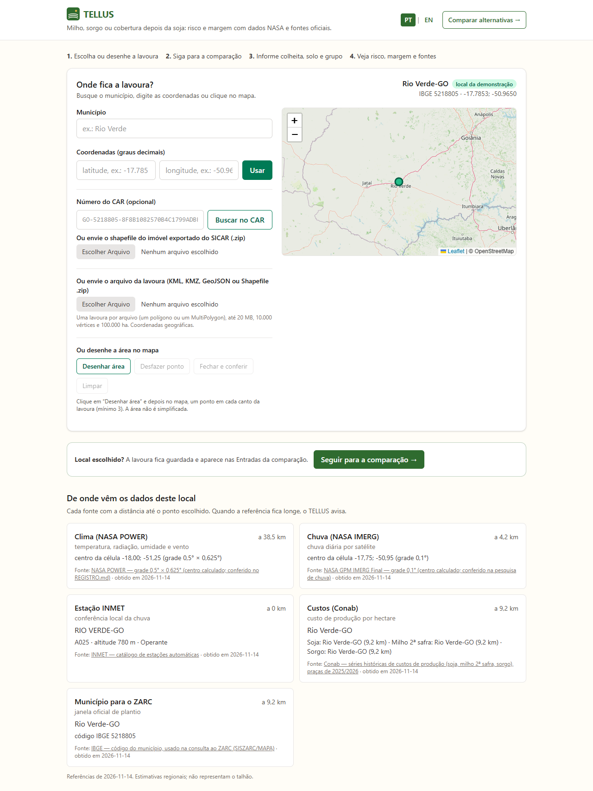

**digitou Rio Verde e viu a lista**

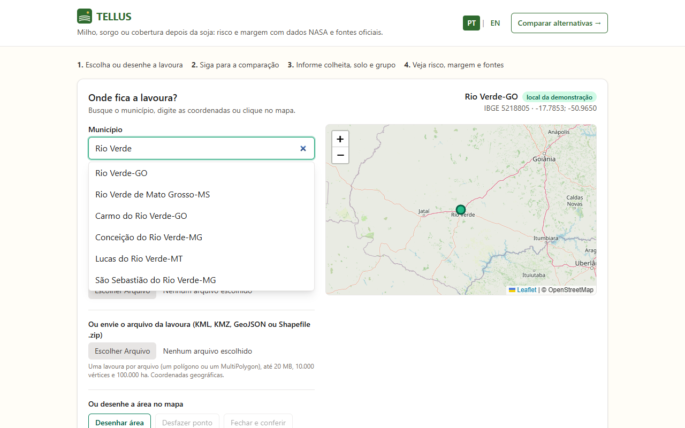

**Rio Verde-GO escolhido**

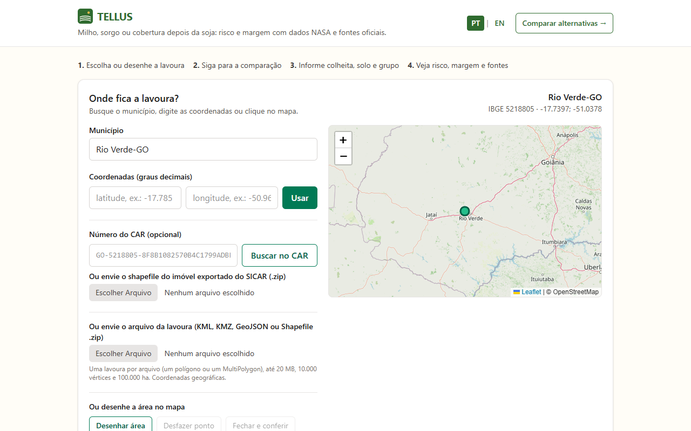

**de onde vêm os dados deste local**

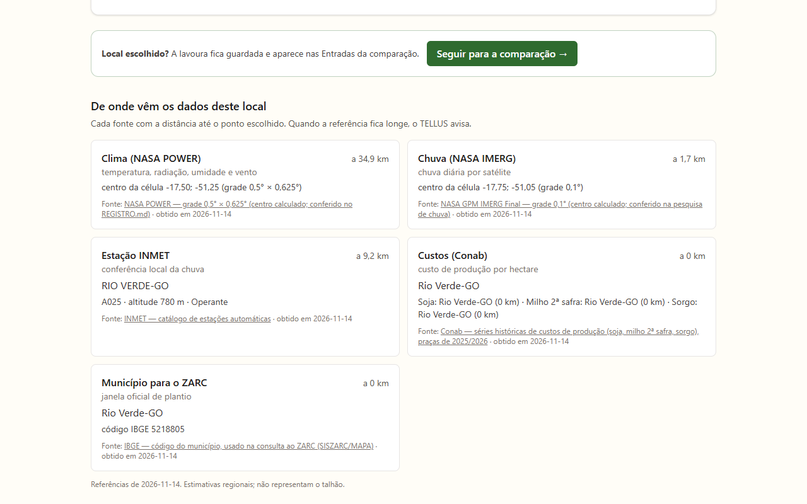

**quatro cantos marcados**

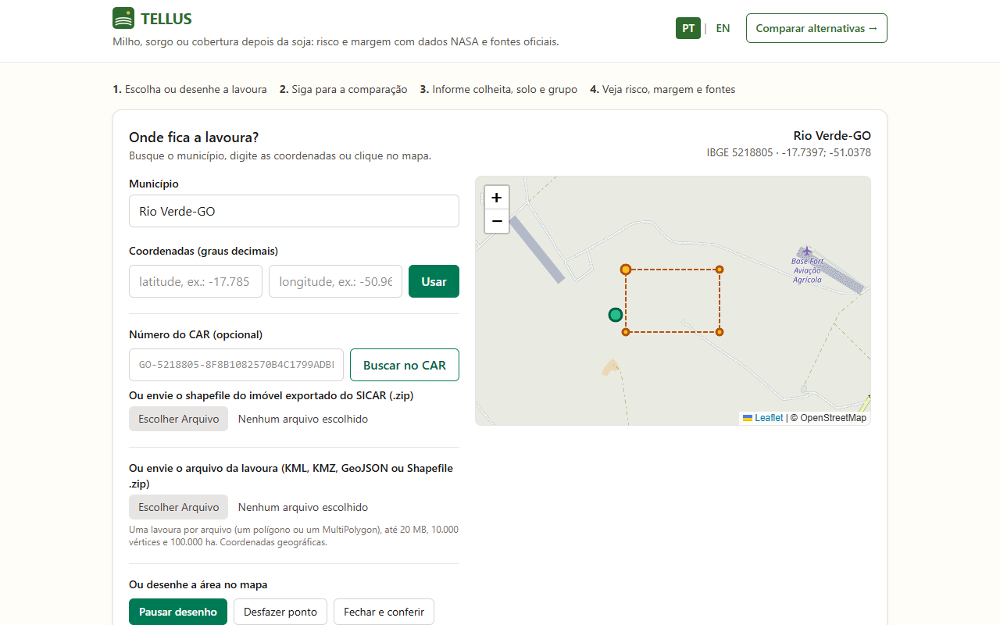

**área para conferir**

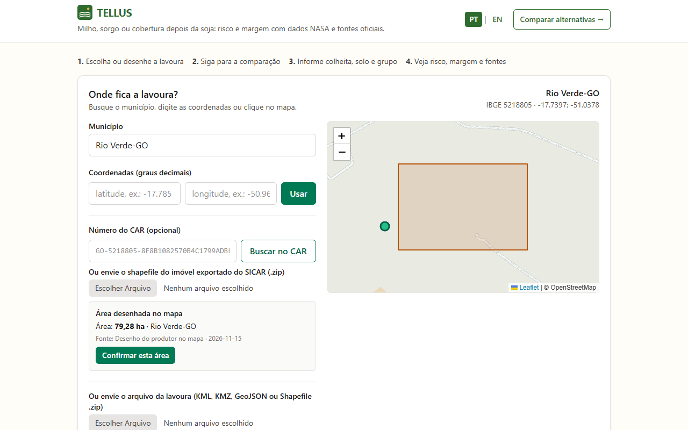

**área confirmada**

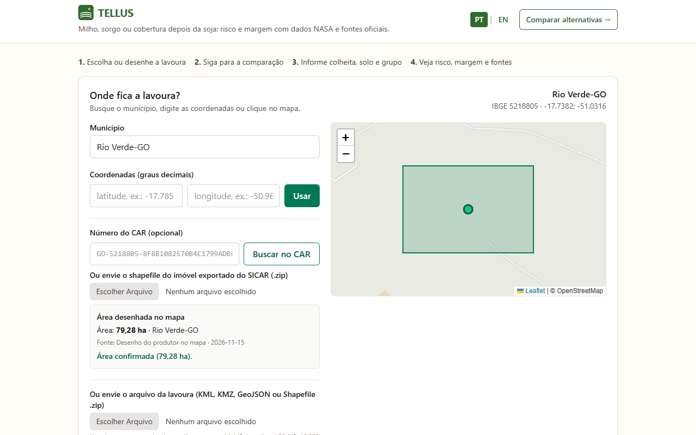

## Passo 2: Entradas

| | O que o roteiro pede | O que apareceu |
|---|---|---|
| ✔ | Aparece "Área confirmada" | Área confirmada: Rio Verde-GO (ponto) |
| ✔ | Sem a faixa amarela "DADO DE EXEMPLO" | faixa ausente |
| ✔ | Apagar a data e tentar seguir: o site avisa em português o que falta | Corrija 1 campo(s) para seguir. · Informe a data da colheita da soja. |

**entradas preenchidas**

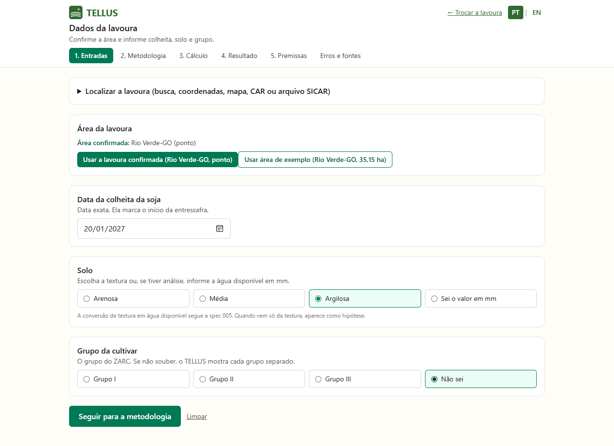

**erro sem a data da colheita**

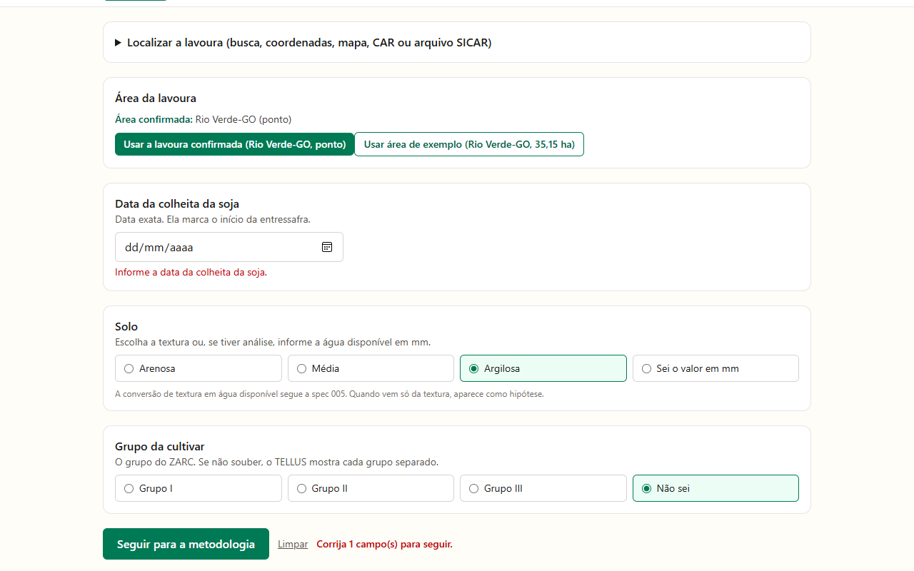

## Passo 3: Metodologia

**comparar as alternativas**

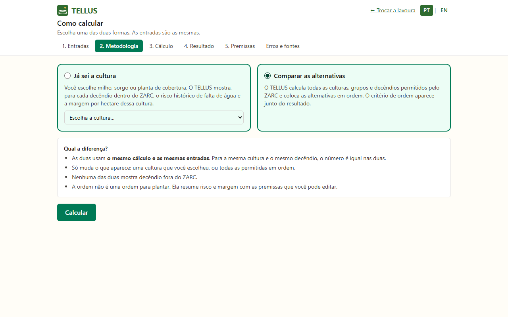

## Passo 4: Resultado (o cálculo de verdade)

| | O que o roteiro pede | O que apareceu |
|---|---|---|
| ✔ | Primeiro aparece "Calculando… etapa atual" | visto: "Calculando… etapa atual" |
| ✔ | Topo diz "Resultado calculado" ou "Resultado PARCIAL" | Resultado calculado |
| ✔ | Lista "Alternativas dentro do ZARC" numerada | 6 alternativas |
| ✔ | Critério de ordem escrito | Critério de ordem: maior margem no cenário conservador; menor risco histórico de falha severa; menor risco oficial do ZARC; plantio mais cedo; desempate final |
| ✔ | Nenhuma faixa amarela de exemplo | faixa ausente |
| ✔ | "Risco oficial (ZARC)" e "Risco histórico de falta de água", separados | dois quadros distintos |
| ✔ | Margem por hectare em 3 cenários | Conservador	-R$ 925 Central	R$ 224 Favorável	R$ 749 |
| ✔ | Lista de Fontes | ZARC, série NASA (IMERG/POWER), Conab |
| ✔ | "O que foi consultado": cada fonte aparece, cópia guardada com a data | O que foi consultado e calculado ◐ NASA GPM IMERG Final (precipitação diária): pronto com cópia guardada (cópia guardada de 2026-11-14) ◐ NASA POWER (variáveis diárias para ETo): pronto com cópia guardada (cópia guardada de 2026-11-14) ✓ Milho 2ª safra: risco hídrico (opcional): pronto (por grupo, na recomendação) ✓ Milho 2ª safra: margem (opcional): pronto (por grupo, na recomendação) ✓ Sorgo granífero 2ª safra: risco hídrico (opcional): pronto (por grupo, na recomendação) ✓ Sorgo granífero 2ª safra: margem (opcional): pronto (por grupo, na recomendação) ✓ Braquiária (cobertura): risco hídrico (opcional): pronto (por grupo, na recomendação) ✓ Braquiária (cobertura): margem (opcional): pronto (por grupo, na recomendação) ✓ Recomendação (ordem das alternativas): pronto ✓ Vegetação (NDVI MODIS) (opcional): pronto ✓ Umidade do solo (SMAP) (opcional): pronto |
| ✔ | O que ficou indisponível mostra o motivo (nenhuma cultura marcada como falha) | culturas "por grupo, na recomendação", sem ✕ |
| ✔ | Vegetação: MODIS disponível e HLS indisponível com o motivo | "MOD13Q1: disponível" e "HLS: indisponível (…)" |
| ✔ | Umidade do solo (SMAP) com aviso de escala | SMAP com aviso de escala regional |
| ✔ | O texto diz que isso não entra no cálculo | "não entra no cálculo" |

**calculando**

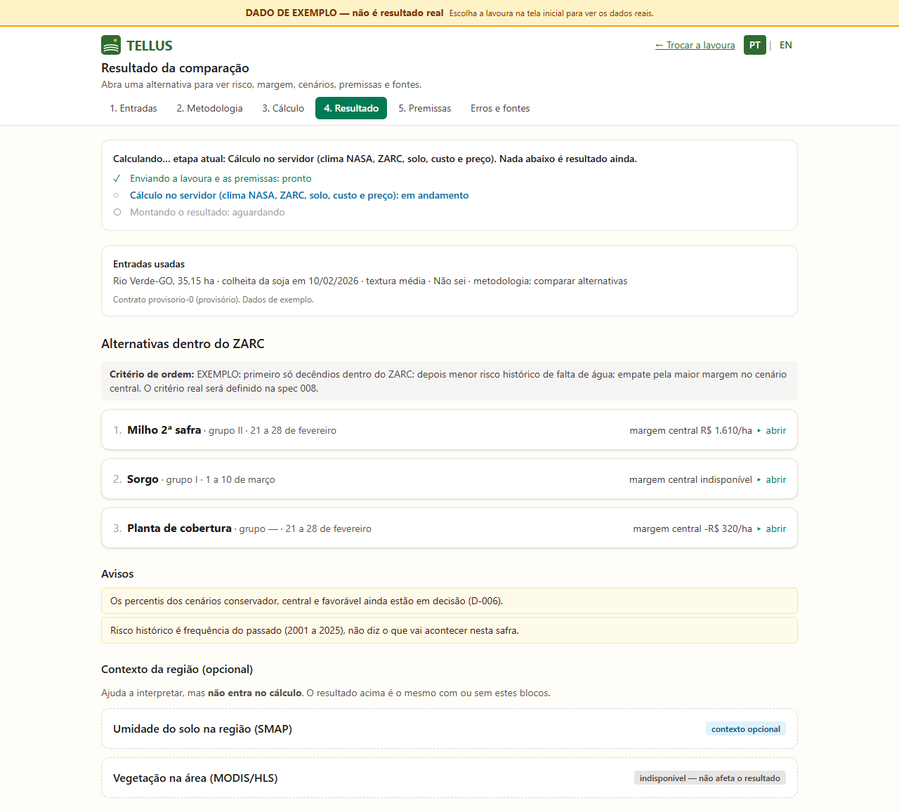

**resultado calculado**

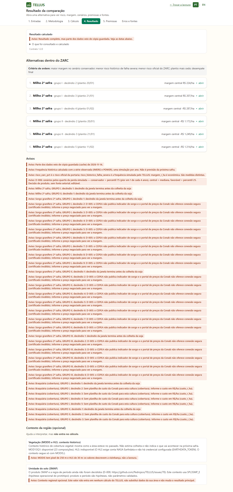

**primeira alternativa aberta**

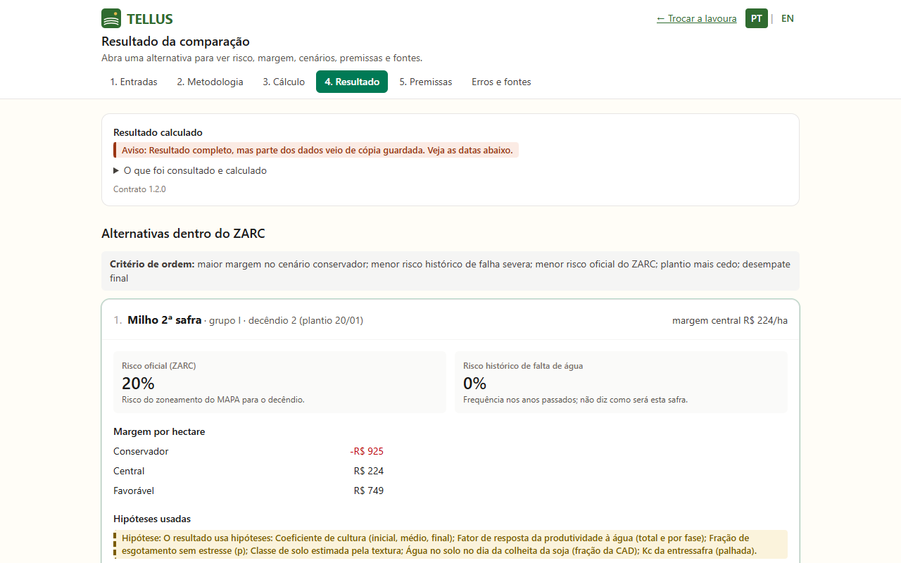

**o que foi consultado e calculado**

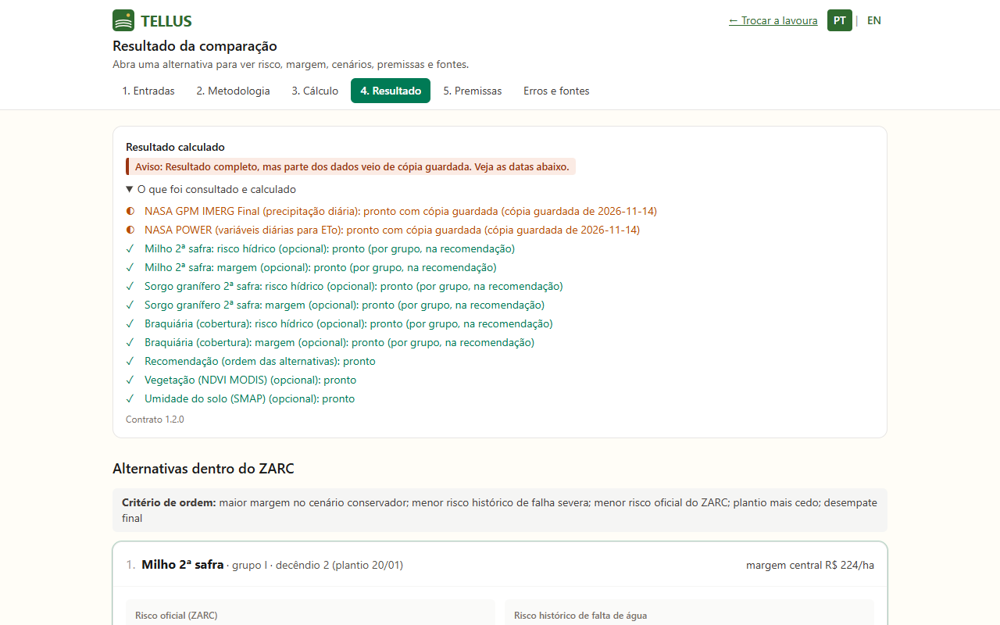

**contexto da região**

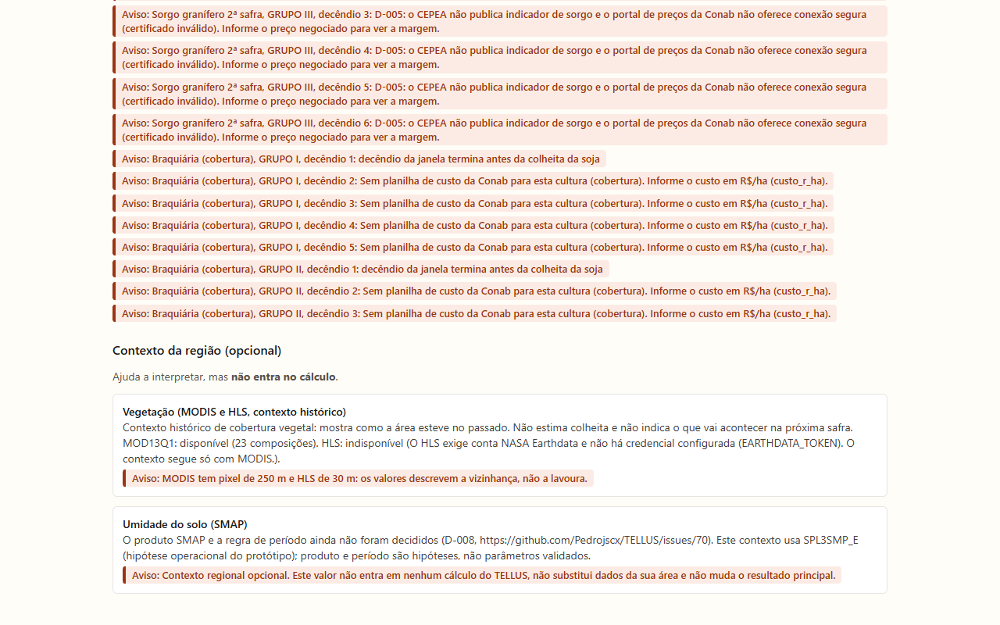

## Passo 5: Premissas: mudar valores e recalcular

| | O que o roteiro pede | O que apareceu |
|---|---|---|
| ✔ | Aparece "Padrões reais para Rio Verde-GO", sem a faixa amarela | Padrões reais para Rio Verde-GO. |
| ✔ | Preço do milho 67,34 (Cepea) | 67,34 R$/saca 60 kg · Fonte do padrão: Cepea/Esalq-USP (INDICADOR DO MILHO ESALQ/BM&FBOVESPA), Campinas-SP (região de referência do indicador), cotação de 2026-11-13 |
| ✔ | Custo 5.889 R$/ha (Conab) | 5.889 R$/ha |
| ✔ | 100 sacas/ha (Conab) | 100 sc/ha |
| ✔ | Água do solo com a fonte do ZARC | Fonte do padrão: Classe AD4 do ZARC (IN SPA/MAPA nº 1/2022 e portaria do milho), a partir da textura (granulometria típica, não medida) · hipótese |
| ✔ | Data futura na cotação: o site recusa | A data da cotação não pode ser no futuro. |
| ✔ | Na alternativa de milho, "Hipóteses usadas" mostra "padrão 67,34 → 70" | Hipótese: preco_r_saca (Milho 2ª safra): padrão 67,34 → 70 R$/saca 60 kg (editado pelo produtor) |
| ✔ | O sorgo aparece com margem e a cotação como informada pela cooperativa | 1.Sorgo granífero 2ª safra · grupo I · decêndio 2 (plantio 20/01) margem central -R$ 514/ha |

**padrões reais**

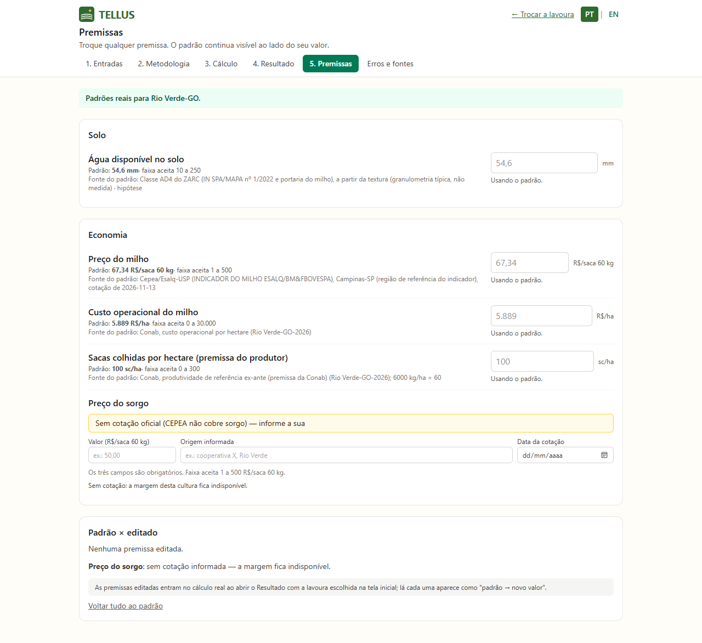

**data futura recusada**

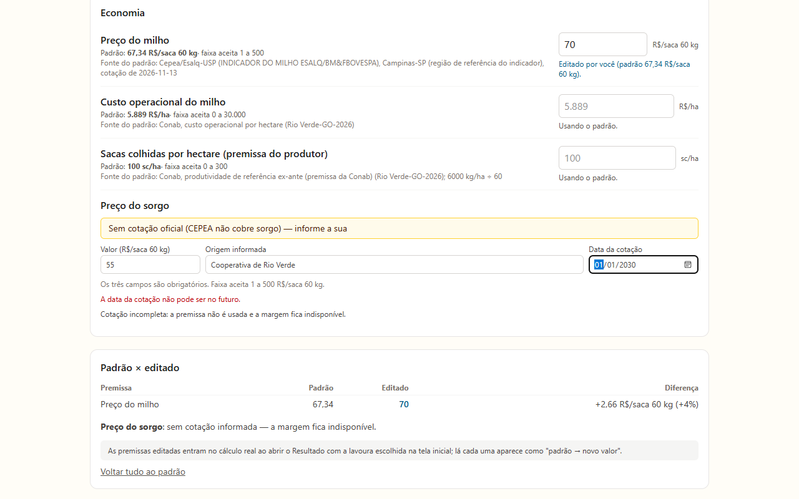

**milho a 70 e sorgo informado**

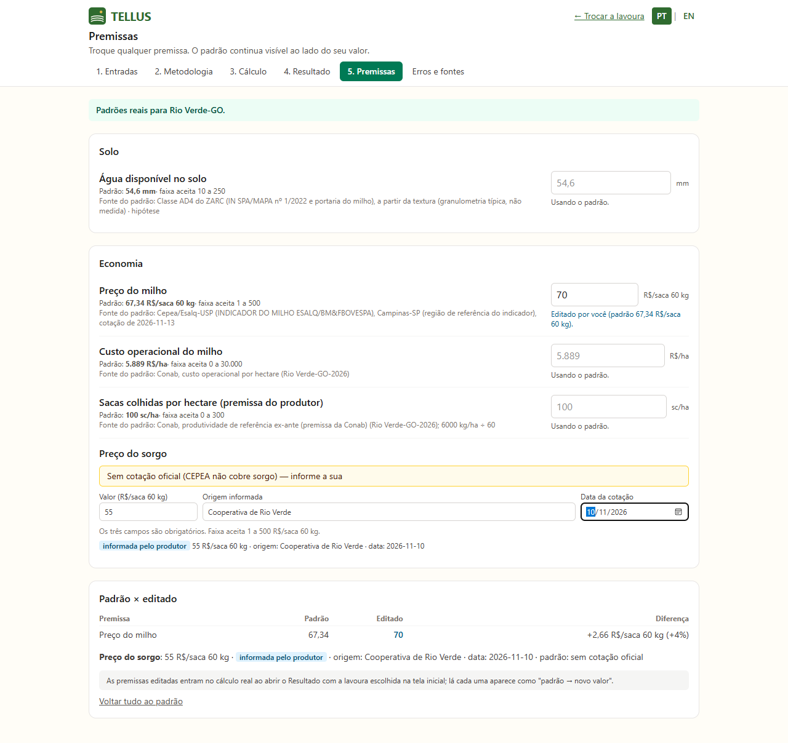

**milho com padrão → novo**

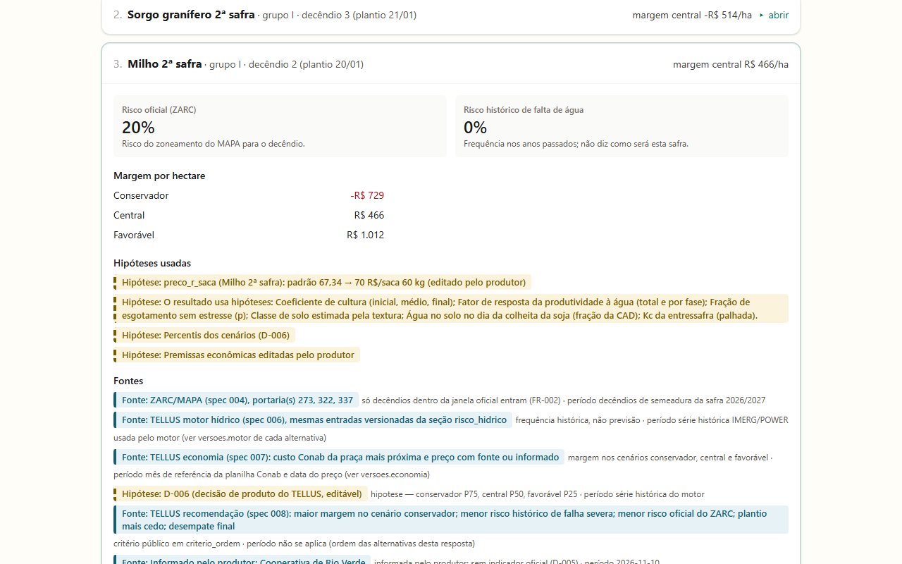

**sorgo com a cotação informada**

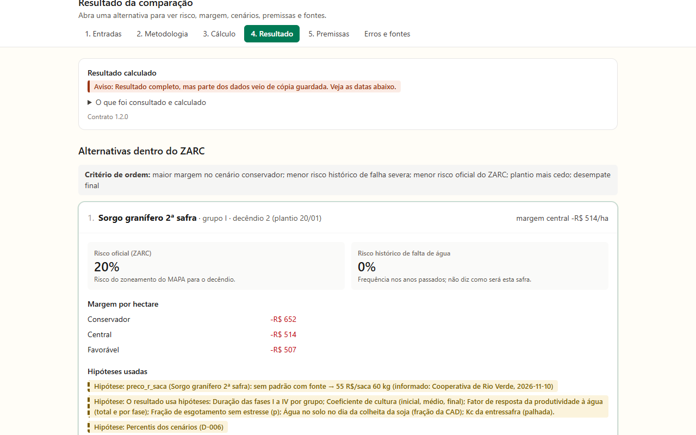

## Passo 6: Não deixar plantar fora do ZARC

| | O que o roteiro pede | O que apareceu |
|---|---|---|
| ✔ | Nenhuma alternativa fora da janela do ZARC | riscos ZARC das 6 alternativas: 20, 20, 20, 20, 30, 40% |
| ✔ | O que não tem dado aparece como indisponível, com o motivo, e não como recomendação | avisos com o motivo (ex.: janela antes da colheita) |

**avisos com os motivos**

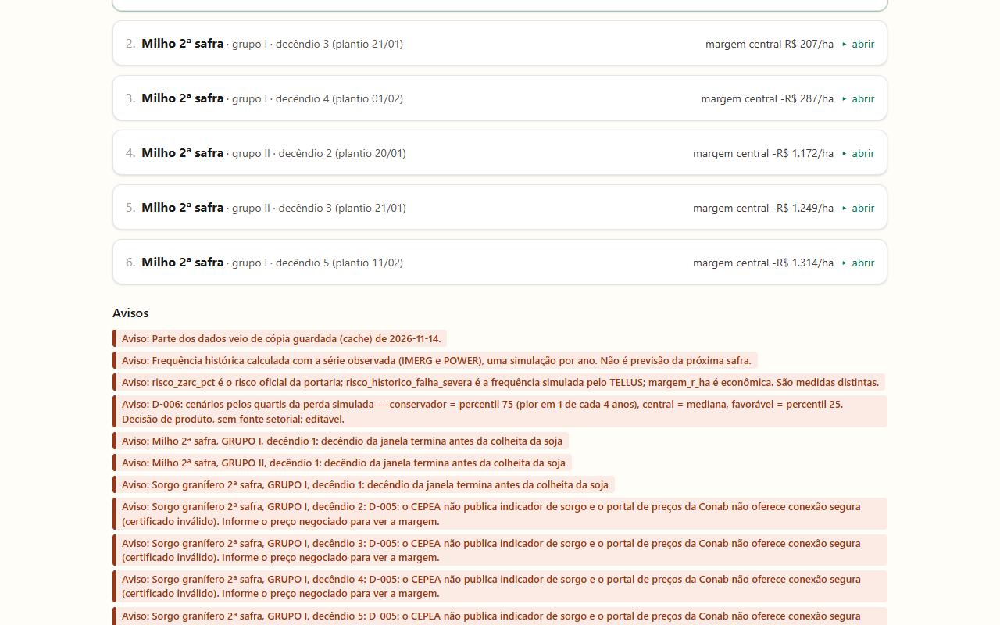

## Passo 7: Celular

| | O que o roteiro pede | O que apareceu |
|---|---|---|
| ✔ | Tela inicial: nada cortado na lateral | 390px de conteúdo em 390px de tela |
| ✔ | O mapa funciona com o dedo | Rio Verde-GO  IBGE 5218805 · -17.7801; -50.9656 |
| ✔ | Entradas: nada cortado na lateral | 390px de conteúdo em 390px de tela |
| ✔ | O menu de etapas quebra linha | 2 linhas |
| ✔ | Resultado: nada cortado na lateral | 390px de conteúdo em 390px de tela |
| ✔ | Alternativa abre com o dedo | riscos e margem visíveis |

**tela inicial no celular**

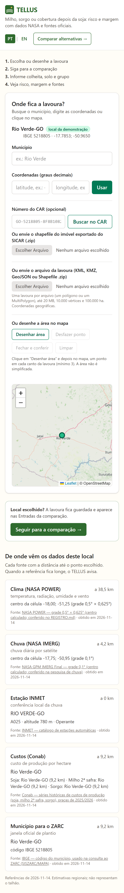

**toque no mapa escolheu um local**

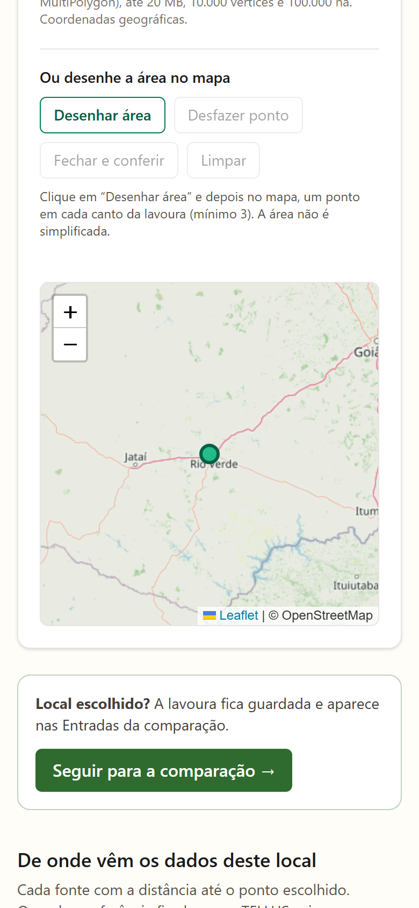

**entradas no celular**

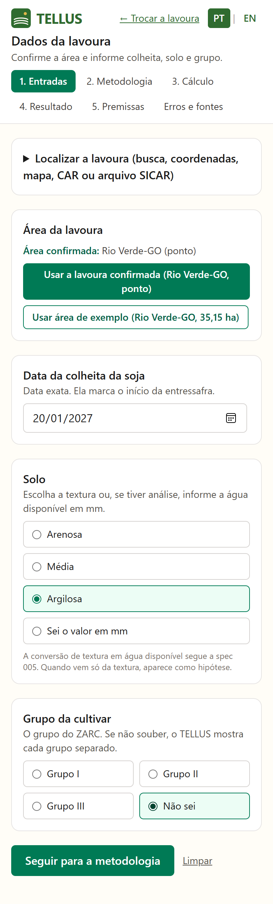

**metodologia no celular**

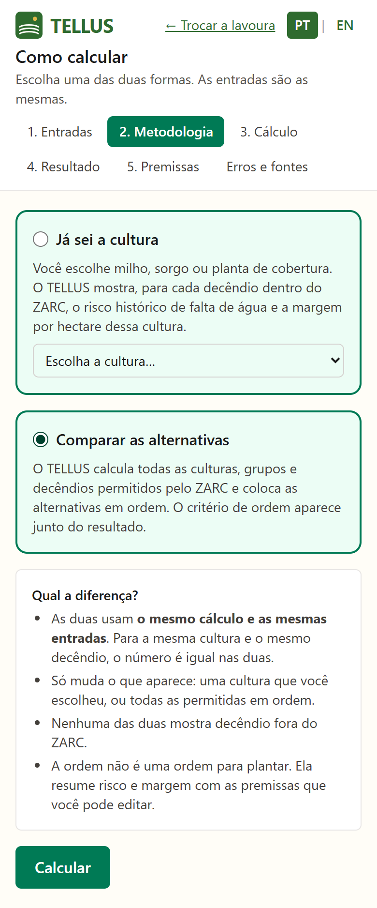

**resultado no celular**

## Passo 8: Telas de demonstração (opcional)

| | O que o roteiro pede | O que apareceu |
|---|---|---|
| ✔ | Tela de demonstração marcada com a faixa amarela | faixa "DADO DE EXEMPLO" visível |
| ✔ | "Falha sem cache": o site não mostra resultado e explica o que fazer | Andamento do cálculo Simular: tudo certo Simular: fonte com cache Simular: falha sem cache  Não foi possível calcular: uma fonte obrigatória falhou e não há cópia guardada.  ✓ Área confirmada — pronto ✓ Calendário ZARC — pronto ✕ Chuva e cl |
| ✔ | "Erros e fontes" mostra como o sistema reage quando uma fonte cai | três estados de uma fonte |

**falha sem cópia guardada**

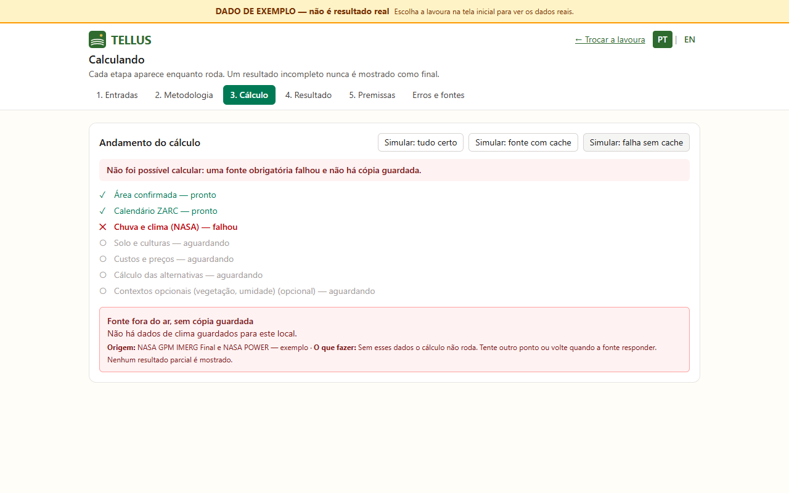

**erros e fontes**

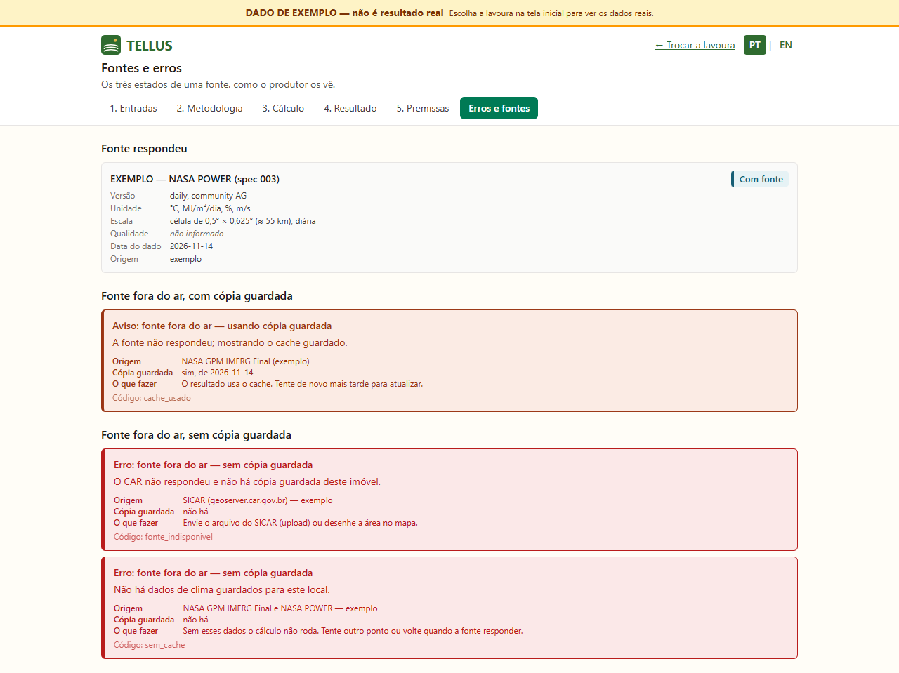
