# Relatório da bateria de testes de ponta a ponta

> Gerado automaticamente por `frontend/e2e/relatorio.ts` ao fim de `npx playwright test`. Não editar à mão:
> rode a bateria de novo para atualizar. Como rodar e o que cada suíte cobre: [README.md](README.md).

## Resumo

| Item | Valor |
|---|---|
| Resultado | **21 de 21 testes conforme o esperado** (0 deles são defeitos conhecidos, abaixo) |
| Verificações | 131 de 131 atendidas (as não atendidas são as dos defeitos conhecidos) |
| Capturas de tela | 45 |
| Início da execução | 15/11/2026, 16:35:48 (horário de Brasília) |
| Commit testado | `b00a3b0` (branch `corrige-grupo-nao-sei`, com 51 arquivo(s) alterado(s) fora do commit) |
| Navegador | Microsoft Edge 157.0.4341.60 (Playwright 1.64.1, Node v24.20.0) |
| Contrato da API | 1.2.0 |
| Dados | API local com as séries e caches versionados do repositório (sem login NASA) |

## Testes

| Suíte | Teste | Resultado | Etapas | Verificações |
|---|---|---|---|---|
| 1. Tela inicial e escolha do local | [Tela inicial abre com marca, passo a passo e seletor de local](#01-tela-inicial-tela-inicial-abre-com-marca-passo-a-passo-e-seletor-de-local) | ✅ passou | 1 | 5/5 |
| 1. Tela inicial e escolha do local | [Escolher Rio Verde-GO pela busca mostra as fontes do local](#01-tela-inicial-escolher-rio-verde-go-pela-busca-mostra-as-fontes-do-local) | ✅ passou | 3 | 8/8 |
| 1. Tela inicial e escolha do local | [Coordenadas digitadas também escolhem o local](#01-tela-inicial-coordenadas-digitadas-tambem-escolhem-o-local) | ✅ passou | 2 | 1/1 |
| 1. Tela inicial e escolha do local | [Coordenada fora do Brasil é recusada com mensagem em português](#01-tela-inicial-coordenada-fora-do-brasil-e-recusada-com-mensagem-em-portugues) | ✅ passou | 1 | 1/1 |
| 1. Tela inicial e escolha do local | [Botão da tela inicial leva à comparação](#01-tela-inicial-botao-da-tela-inicial-leva-a-comparacao) | ✅ passou | 1 | 5/5 |
| 2. Entradas e validação | [Entradas vazias não seguem e explicam o que falta](#02-entradas-entradas-vazias-nao-seguem-e-explicam-o-que-falta) | ✅ passou | 1 | 2/2 |
| 2. Entradas e validação | [Água disponível em mm aceita só número positivo](#02-entradas-agua-disponivel-em-mm-aceita-so-numero-positivo) | ✅ passou | 1 | 4/4 |
| 2. Entradas e validação | [Caso de referência preenchido segue para a metodologia](#02-entradas-caso-de-referencia-preenchido-segue-para-a-metodologia) | ✅ passou | 2 | 6/6 |
| 2. Entradas e validação | [Metodologia sem escolha não calcula](#02-entradas-metodologia-sem-escolha-nao-calcula) | ✅ passou | 1 | 7/7 |
| 3. Cálculo real (Rio Verde-GO) | [Caso de referência: Rio Verde-GO, colheita 20/01/2027, argilosa, grupo "não sei"](#03-calculo-real-caso-de-referencia-rio-verde-go-colheita-20-01-2027-argilosa-grupo-nao-sei-) | ✅ passou | 6 | 19/19 |
| 3. Cálculo real (Rio Verde-GO) | [Grupo "não sei": "O que foi consultado" lista as fontes de clima e as culturas calculadas por grupo](#03-calculo-real-grupo-nao-sei-o-que-foi-consultado-lista-as-fontes-de-clima-e-as-culturas-calculadas-por-grupo) | ✅ passou | 2 | 9/9 |
| 4. Premissas editadas e recálculo | [Premissas mostram os padrões reais e a edição chega ao cálculo](#04-premissas-premissas-mostram-os-padroes-reais-e-a-edicao-chega-ao-calculo) | ✅ passou | 5 | 16/16 |
| 4. Premissas editadas e recálculo | [Grupo "não sei": o resultado mostra o padrão ao lado do preço editado](#04-premissas-grupo-nao-sei-o-resultado-mostra-o-padrao-ao-lado-do-preco-editado) | ✅ passou | 1 | 7/7 |
| 5. Versão em inglês (spec 014) | [Trocar para inglês no topo vale em todas as telas e no resultado real](#05-idioma-trocar-para-ingles-no-topo-vale-em-todas-as-telas-e-no-resultado-real) | ✅ passou | 5 | 10/10 |
| 5. Versão em inglês (spec 014) | [Link com ?lang=en abre direto em inglês](#05-idioma-link-com-lang-en-abre-direto-em-ingles) | ✅ passou | 1 | 1/1 |
| 6. Celular (390 × 844) | [Fluxo completo no celular sem nada cortado na lateral](#06-celular-fluxo-completo-no-celular-sem-nada-cortado-na-lateral) | ✅ passou | 4 | 11/11 |
| 7. Telas de erro simuladas | [Tela de cálculo simula sucesso, fonte com cópia guardada e falha sem cópia](#07-erros-simulados-tela-de-calculo-simula-sucesso-fonte-com-copia-guardada-e-falha-sem-copia) | ✅ passou | 4 | 5/5 |
| 7. Telas de erro simuladas | [Tela de erros mostra os três estados de uma fonte](#07-erros-simulados-tela-de-erros-mostra-os-tres-estados-de-uma-fonte) | ✅ passou | 1 | 4/4 |
| 8. API do contrato | [Mesmo pedido em PT e EN dá os mesmos números, ordem e hash](#08-api-mesmo-pedido-em-pt-e-en-da-os-mesmos-numeros-ordem-e-hash) | ✅ passou | 1 | 6/6 |
| 8. API do contrato | [Versões do contrato: 1.1.0 aceita, 2.0.0 recusada com as versões aceitas](#08-api-versoes-do-contrato-1-1-0-aceita-2-0-0-recusada-com-as-versoes-aceitas) | ✅ passou | 1 | 3/3 |
| 8. API do contrato | [Pedido sem área confirmada não começa o cálculo](#08-api-pedido-sem-area-confirmada-nao-comeca-o-calculo) | ✅ passou | 1 | 1/1 |

## 1. Tela inicial e escolha do local

### Tela inicial abre com marca, passo a passo e seletor de local

✅ passou · arquivo `frontend/e2e/01-tela-inicial.e2e.ts` · tela 1280×900 · 15/11/2026, 16:35:49 → 15/11/2026, 16:35:49

#### Etapa 1: tela inicial

URL: `/`

| | Verificação | Esperado | Obtido |
|---|---|---|---|
| ✅ | Título da aba | TELLUS · segunda safra | TELLUS · segunda safra |
| ✅ | Ícone próprio do TELLUS na aba | /favicon.svg | /favicon.svg?v=2 |
| ✅ | Passo a passo de 4 etapas | 4 itens em "Como usar" | 1. Escolha ou desenhe a lavoura 2. Siga para a comparação 3. Informe colheita, solo e grupo 4. Veja risco, margem e fontes |
| ✅ | Sem faixa de dado de exemplo na tela inicial | nenhum "DADO DE EXEMPLO" | conforme o esperado |
| ✅ | Seletor de idioma no topo | botões PT e EN, PT marcado | conforme o esperado |

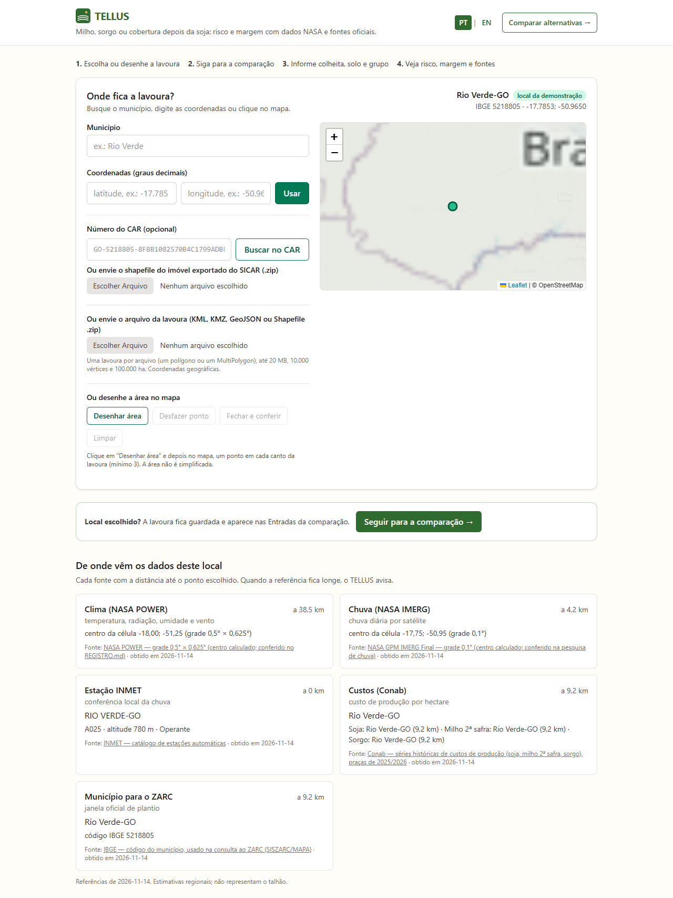

### Escolher Rio Verde-GO pela busca mostra as fontes do local

✅ passou · arquivo `frontend/e2e/01-tela-inicial.e2e.ts` · tela 1280×900 · 15/11/2026, 16:35:50 → 15/11/2026, 16:35:51

#### Etapa 1: busca por Rio Verde

URL: `/`

| | Verificação | Esperado | Obtido |
|---|---|---|---|
| ✅ | Busca de município sugere Rio Verde-GO | opção "Rio Verde-GO" na lista | Rio Verde-GO Rio Verde de Mato Grosso-MS Carmo do Rio Verde-GO Conceição do Rio Verde-MG Lucas do Rio Verde-MT São Sebastião do Rio Verde-MG |

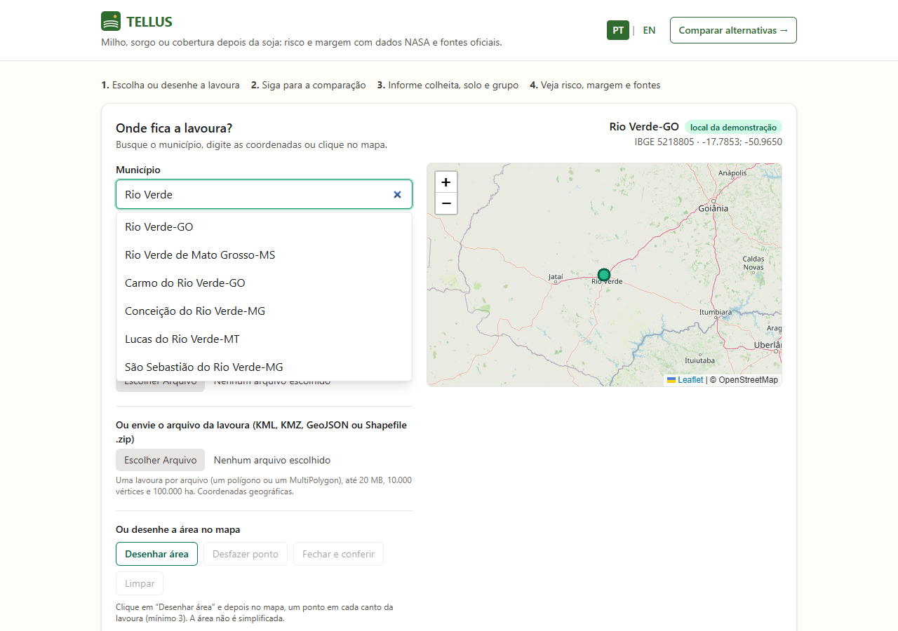

#### Etapa 2: Rio Verde-GO escolhido

URL: `/`

| | Verificação | Esperado | Obtido |
|---|---|---|---|
| ✅ | Local escolhido aparece no topo do seletor | Rio Verde-GO | Rio Verde-GO  IBGE 5218805 · -17.7397; -51.0378 |
| ✅ | Lavoura guardada para a comparação | lavoura salva no navegador (sessionStorage) | {"tipo":"ponto","lat":-17.73971,"lon":-51.03782,"codigo_ibge":"5218805","municipio":"Rio Verde","uf":"GO","area_ha":null |

#### Etapa 3: fontes do local escolhido

URL: `/`

| | Verificação | Esperado | Obtido |
|---|---|---|---|
| ✅ | Fonte "NASA POWER" listada com distância | NASA POWER | conforme o esperado |
| ✅ | Fonte "IMERG" listada com distância | IMERG | conforme o esperado |
| ✅ | Fonte "INMET" listada com distância | INMET | conforme o esperado |
| ✅ | Fonte "Conab" listada com distância | Conab | conforme o esperado |
| ✅ | Fonte "ZARC" listada com distância | ZARC | conforme o esperado |

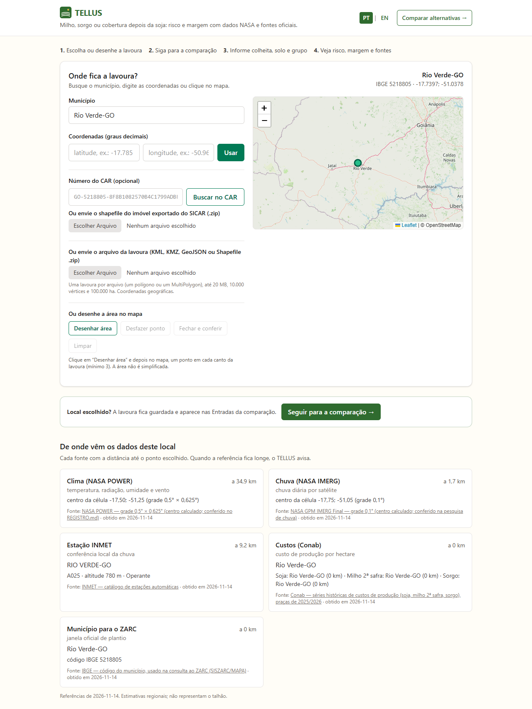

### Coordenadas digitadas também escolhem o local

✅ passou · arquivo `frontend/e2e/01-tela-inicial.e2e.ts` · tela 1280×900 · 15/11/2026, 16:35:52 → 15/11/2026, 16:35:52

#### Etapa 1: coordenadas digitadas

URL: `/`

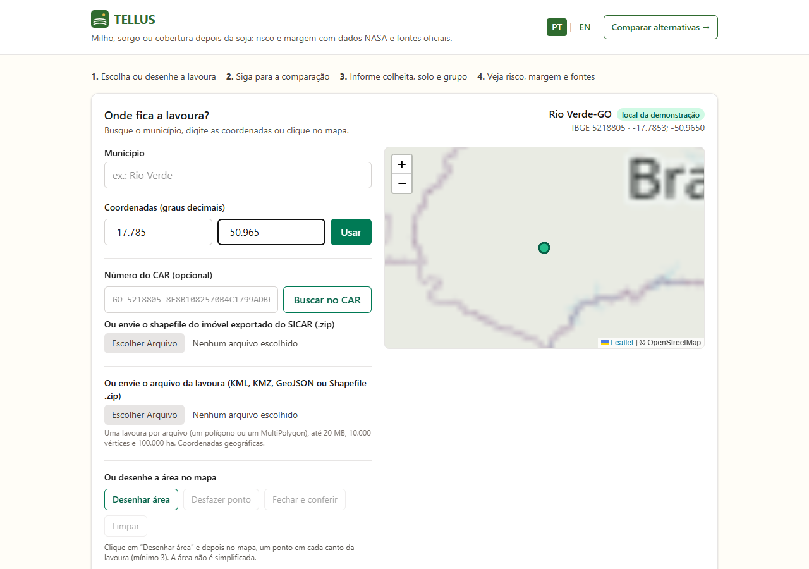

#### Etapa 2: local pelas coordenadas

URL: `/`

| | Verificação | Esperado | Obtido |
|---|---|---|---|
| ✅ | Coordenadas de Rio Verde resolvem o município | Rio Verde-GO | Rio Verde-GO  IBGE 5218805 · -17.7850; -50.9650 |

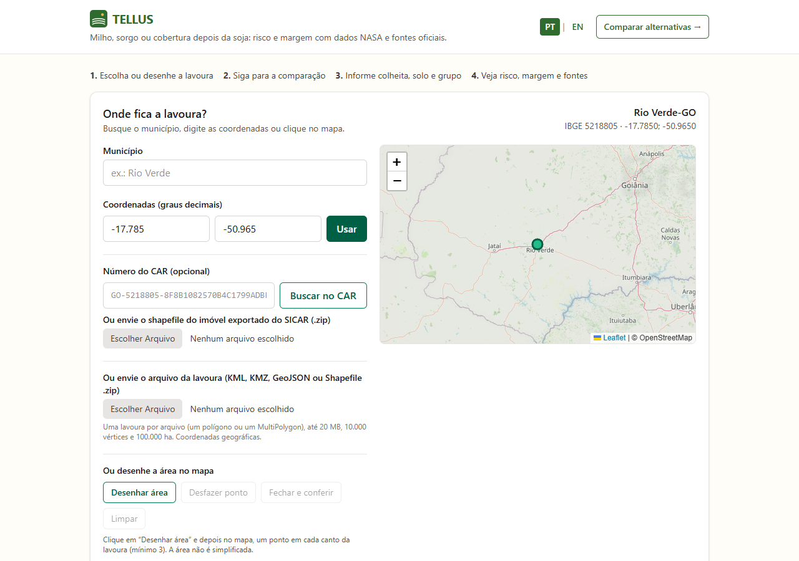

### Coordenada fora do Brasil é recusada com mensagem em português

✅ passou · arquivo `frontend/e2e/01-tela-inicial.e2e.ts` · tela 1280×900 · 15/11/2026, 16:35:53 → 15/11/2026, 16:35:53

#### Etapa 1: ponto fora do Brasil recusado

URL: `/`

| | Verificação | Esperado | Obtido |
|---|---|---|---|
| ✅ | Erro legível para ponto fora do território | mensagem de erro visível | O TELLUS cobre apenas o território brasileiro. |

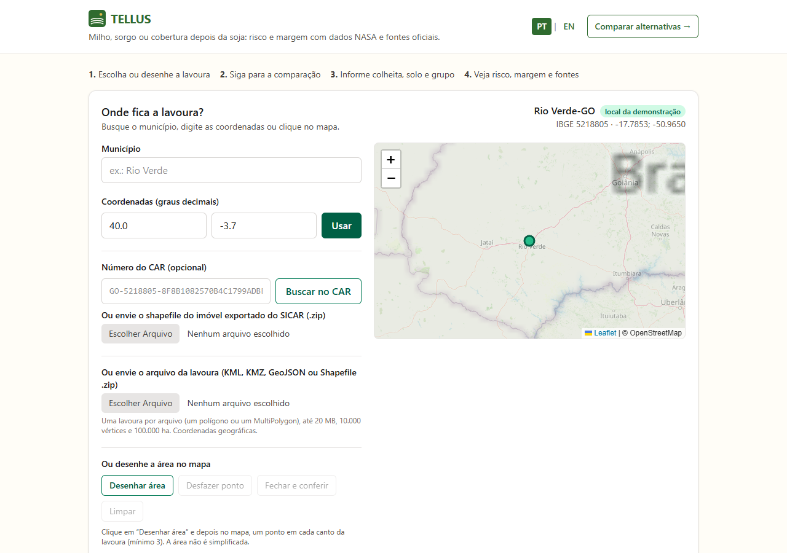

### Botão da tela inicial leva à comparação

✅ passou · arquivo `frontend/e2e/01-tela-inicial.e2e.ts` · tela 1280×900 · 15/11/2026, 16:35:54 → 15/11/2026, 16:35:55

#### Etapa 1: entradas com a lavoura escolhida

URL: `/comparacao/entradas`

| | Verificação | Esperado | Obtido |
|---|---|---|---|
| ✅ | Busca de município sugere Rio Verde-GO | opção "Rio Verde-GO" na lista | Rio Verde-GO Rio Verde de Mato Grosso-MS Carmo do Rio Verde-GO Conceição do Rio Verde-MG Lucas do Rio Verde-MT São Sebastião do Rio Verde-MG |
| ✅ | Local escolhido aparece no topo do seletor | Rio Verde-GO | Rio Verde-GO  IBGE 5218805 · -17.7397; -51.0378 |
| ✅ | Lavoura guardada para a comparação | lavoura salva no navegador (sessionStorage) | {"tipo":"ponto","lat":-17.73971,"lon":-51.03782,"codigo_ibge":"5218805","municipio":"Rio Verde","uf":"GO","area_ha":null |
| ✅ | Link abre as Entradas | URL /comparacao/entradas | http://localhost:4321/comparacao/entradas |
| ✅ | Lavoura escolhida oferecida nas Entradas | botão "Usar a lavoura confirmada (Rio Verde-GO, ponto)" | Usar a lavoura confirmada (Rio Verde-GO, ponto) |

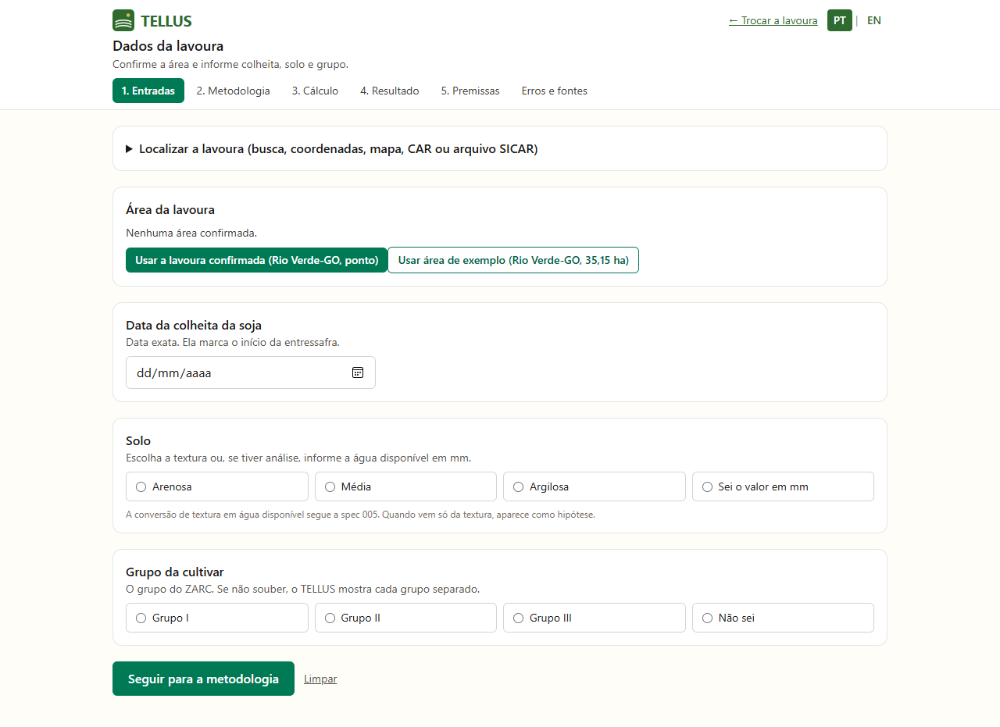

## 2. Entradas e validação

### Entradas vazias não seguem e explicam o que falta

✅ passou · arquivo `frontend/e2e/02-entradas.e2e.ts` · tela 1280×900 · 15/11/2026, 16:35:56 → 15/11/2026, 16:35:56

#### Etapa 1: erros de entradas vazias

URL: `/comparacao/entradas`

| | Verificação | Esperado | Obtido |
|---|---|---|---|
| ✅ | Resumo de erros aparece | lista do que falta, em português | Corrija 4 campo(s) para seguir. |
| ✅ | Continua nas Entradas | URL /comparacao/entradas | conforme o esperado |

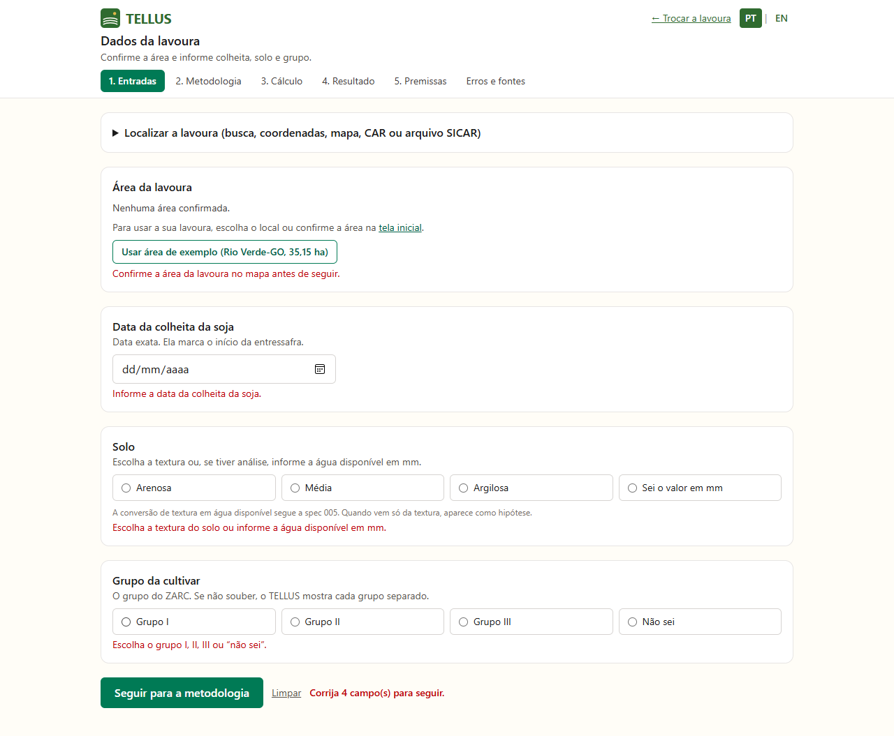

### Água disponível em mm aceita só número positivo

✅ passou · arquivo `frontend/e2e/02-entradas.e2e.ts` · tela 1280×900 · 15/11/2026, 16:35:57 → 15/11/2026, 16:35:58

#### Etapa 1: agua disponivel negativa recusada

URL: `/comparacao/entradas`

| | Verificação | Esperado | Obtido |
|---|---|---|---|
| ✅ | Busca de município sugere Rio Verde-GO | opção "Rio Verde-GO" na lista | Rio Verde-GO Rio Verde de Mato Grosso-MS Carmo do Rio Verde-GO Conceição do Rio Verde-MG Lucas do Rio Verde-MT São Sebastião do Rio Verde-MG |
| ✅ | Local escolhido aparece no topo do seletor | Rio Verde-GO | Rio Verde-GO  IBGE 5218805 · -17.7397; -51.0378 |
| ✅ | Lavoura guardada para a comparação | lavoura salva no navegador (sessionStorage) | {"tipo":"ponto","lat":-17.73971,"lon":-51.03782,"codigo_ibge":"5218805","municipio":"Rio Verde","uf":"GO","area_ha":null |
| ✅ | Valor negativo recusado | erro sobre a água disponível | Corrija 1 campo(s) para seguir. |

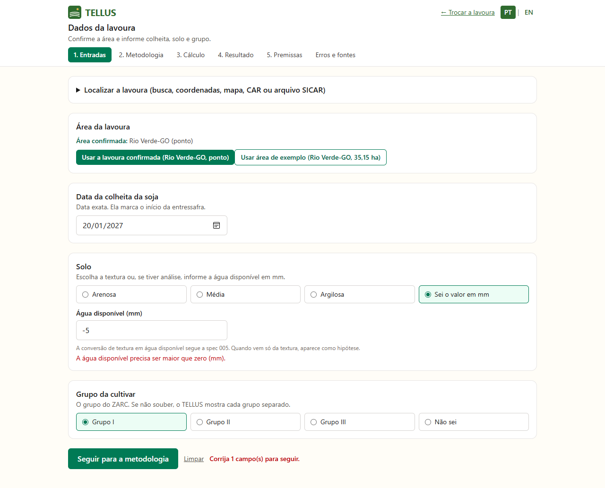

### Caso de referência preenchido segue para a metodologia

✅ passou · arquivo `frontend/e2e/02-entradas.e2e.ts` · tela 1280×900 · 15/11/2026, 16:35:59 → 15/11/2026, 16:36:01

#### Etapa 1: entradas preenchidas

URL: `/comparacao/entradas`

| | Verificação | Esperado | Obtido |
|---|---|---|---|
| ✅ | Busca de município sugere Rio Verde-GO | opção "Rio Verde-GO" na lista | Rio Verde-GO Rio Verde de Mato Grosso-MS Carmo do Rio Verde-GO Conceição do Rio Verde-MG Lucas do Rio Verde-MT São Sebastião do Rio Verde-MG |
| ✅ | Local escolhido aparece no topo do seletor | Rio Verde-GO | Rio Verde-GO  IBGE 5218805 · -17.7397; -51.0378 |
| ✅ | Lavoura guardada para a comparação | lavoura salva no navegador (sessionStorage) | {"tipo":"ponto","lat":-17.73971,"lon":-51.03782,"codigo_ibge":"5218805","municipio":"Rio Verde","uf":"GO","area_ha":null |
| ✅ | Área confirmada a partir da lavoura da tela inicial | estado da área com Rio Verde | Área confirmada: Rio Verde-GO (ponto) |

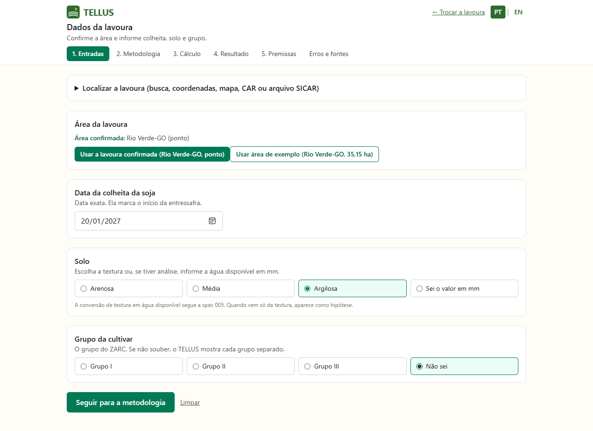

#### Etapa 2: metodologia aberta

URL: `/comparacao/metodologia`

| | Verificação | Esperado | Obtido |
|---|---|---|---|
| ✅ | Entradas válidas levam à metodologia | URL /comparacao/metodologia | http://localhost:4321/comparacao/metodologia |
| ✅ | Sem faixa de dado de exemplo com lavoura real | nenhum "DADO DE EXEMPLO" | conforme o esperado |

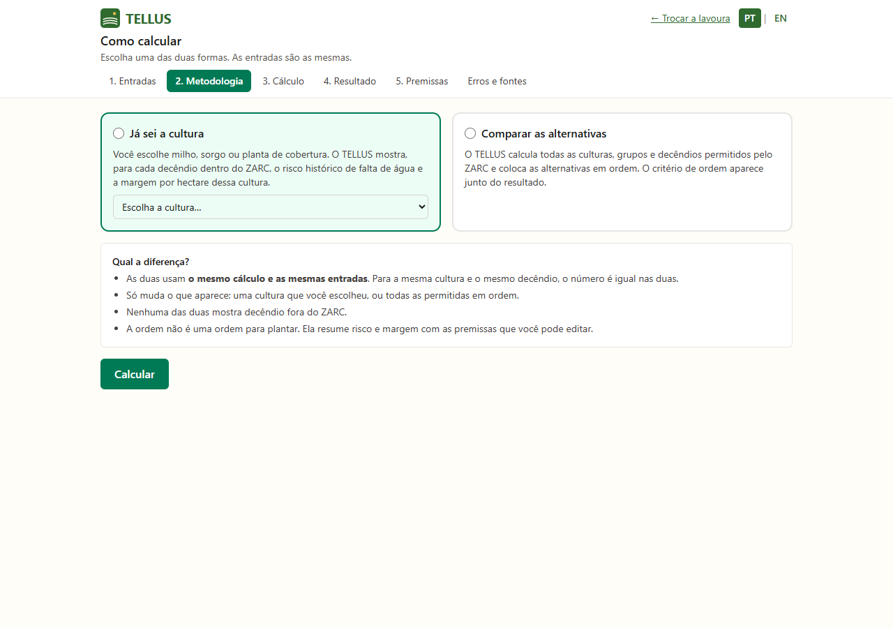

### Metodologia sem escolha não calcula

✅ passou · arquivo `frontend/e2e/02-entradas.e2e.ts` · tela 1280×900 · 15/11/2026, 16:36:01 → 15/11/2026, 16:36:03

#### Etapa 1: metodologia sem escolha

URL: `/comparacao/metodologia`

| | Verificação | Esperado | Obtido |
|---|---|---|---|
| ✅ | Busca de município sugere Rio Verde-GO | opção "Rio Verde-GO" na lista | Rio Verde-GO Rio Verde de Mato Grosso-MS Carmo do Rio Verde-GO Conceição do Rio Verde-MG Lucas do Rio Verde-MT São Sebastião do Rio Verde-MG |
| ✅ | Local escolhido aparece no topo do seletor | Rio Verde-GO | Rio Verde-GO  IBGE 5218805 · -17.7397; -51.0378 |
| ✅ | Lavoura guardada para a comparação | lavoura salva no navegador (sessionStorage) | {"tipo":"ponto","lat":-17.73971,"lon":-51.03782,"codigo_ibge":"5218805","municipio":"Rio Verde","uf":"GO","area_ha":null |
| ✅ | Área confirmada a partir da lavoura da tela inicial | estado da área com Rio Verde | Área confirmada: Rio Verde-GO (ponto) |
| ✅ | Entradas válidas levam à metodologia | URL /comparacao/metodologia | http://localhost:4321/comparacao/metodologia |
| ✅ | Pede para escolher a forma de calcular | mensagem de erro da metodologia | Escolha uma das duas formas de calcular. |
| ✅ | Continua na metodologia | URL /comparacao/metodologia | conforme o esperado |

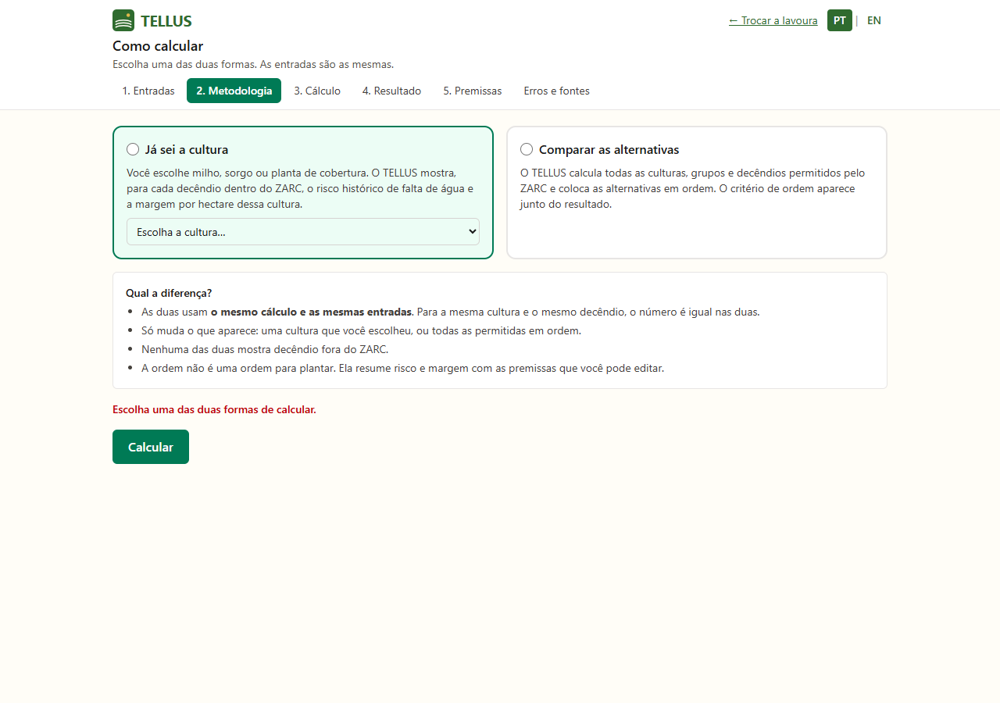

## 3. Cálculo real (Rio Verde-GO)

### Caso de referência: Rio Verde-GO, colheita 20/01/2027, argilosa, grupo "não sei"

✅ passou · arquivo `frontend/e2e/03-calculo-real.e2e.ts` · tela 1280×900 · 15/11/2026, 16:36:03 → 15/11/2026, 16:36:08

#### Etapa 1: metodologia: comparar as alternativas

URL: `/comparacao/metodologia`

| | Verificação | Esperado | Obtido |
|---|---|---|---|
| ✅ | Busca de município sugere Rio Verde-GO | opção "Rio Verde-GO" na lista | Rio Verde-GO Rio Verde de Mato Grosso-MS Carmo do Rio Verde-GO Conceição do Rio Verde-MG Lucas do Rio Verde-MT São Sebastião do Rio Verde-MG |
| ✅ | Local escolhido aparece no topo do seletor | Rio Verde-GO | Rio Verde-GO  IBGE 5218805 · -17.7397; -51.0378 |
| ✅ | Lavoura guardada para a comparação | lavoura salva no navegador (sessionStorage) | {"tipo":"ponto","lat":-17.73971,"lon":-51.03782,"codigo_ibge":"5218805","municipio":"Rio Verde","uf":"GO","area_ha":null |
| ✅ | Área confirmada a partir da lavoura da tela inicial | estado da área com Rio Verde | Área confirmada: Rio Verde-GO (ponto) |
| ✅ | Entradas válidas levam à metodologia | URL /comparacao/metodologia | http://localhost:4321/comparacao/metodologia |

#### Etapa 2: resultado calculado

URL: `/comparacao/resultado`

| | Verificação | Esperado | Obtido |
|---|---|---|---|
| ✅ | Cálculo real termina e mostra o estado do resultado | "Resultado calculado" ou "Resultado parcial" | Resultado calculado |
| ✅ | Contrato da API informado | Contrato 1.2.0 | conforme o esperado |
| ✅ | Sem faixa de dado de exemplo no resultado real | nenhum "DADO DE EXEMPLO" visível | conforme o esperado |
| ✅ | Lista ordenada de alternativas dentro do ZARC | ao menos 1 alternativa | 6 alternativas |
| ✅ | Critério de ordem escrito | começa por "maior margem no cenário conservador" | Critério de ordem: maior margem no cenário conservador; menor risco histórico de falha severa; menor risco oficial do ZARC; plantio mais cedo; desempate final |

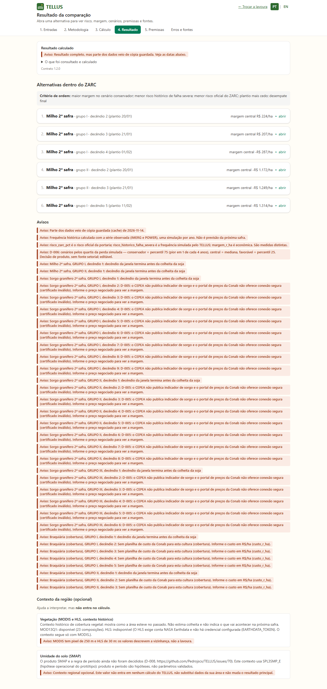

#### Etapa 3: primeira alternativa aberta

URL: `/comparacao/resultado`

| | Verificação | Esperado | Obtido |
|---|---|---|---|
| ✅ | Risco oficial do ZARC separado | Risco oficial (ZARC) | conforme o esperado |
| ✅ | Risco histórico separado | Risco histórico de falta de água | conforme o esperado |
| ✅ | Fontes da alternativa | Fontes | conforme o esperado |
| ✅ | Margem em 3 cenários | Conservador, Central e Favorável | Conservador	-R$ 925 Central	R$ 224 Favorável	R$ 749 |
| ✅ | Fontes citam a série NASA (IMERG/POWER), o ZARC e a Conab | IMERG/POWER, ZARC e Conab entre as fontes | conforme o esperado |

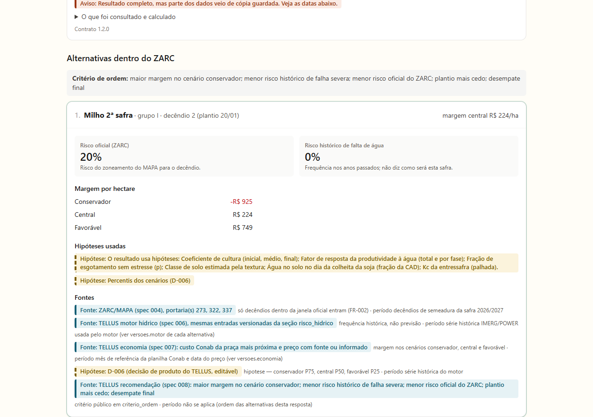

#### Etapa 4: o que foi consultado e calculado

URL: `/comparacao/resultado`

| | Verificação | Esperado | Obtido |
|---|---|---|---|
| ✅ | Recomendação listada como pronta | "Recomendação (ordem das alternativas): pronto" | O que foi consultado e calculado ◐ NASA GPM IMERG Final (precipitação diária): pronto com cópia guardada (cópia guardada de 2026-11-14) ◐ NASA POWER (variáveis diárias para ETo): pronto com cópia guardada (cópia guardada de 2026-11-14) ✓ Milho 2ª safra: risco hídrico (opcional): pronto (por grupo, na recomendação) ✓ Milho 2ª safra: margem (opcional): pronto (por grupo, na recomendação) ✓ Sorgo granífero 2ª safra: risco hídrico (opcional): pronto (por grupo, na recomendação) ✓ Sorgo granífero 2ª safra: margem (opcional): pronto (por grupo, na recomendação) ✓ Braquiária (cobertura): risco hídrico (opcional): pronto (por grupo, na recomendação) ✓ Braquiária (cobertura): margem (opcional): pronto (por grupo, na recomendação) ✓ Recomendação (ordem das alternativas): pronto ✓ Vegetação (NDVI MODIS) (opcional): pronto ✓ Umidade do solo (SMAP) (opcional): pronto |

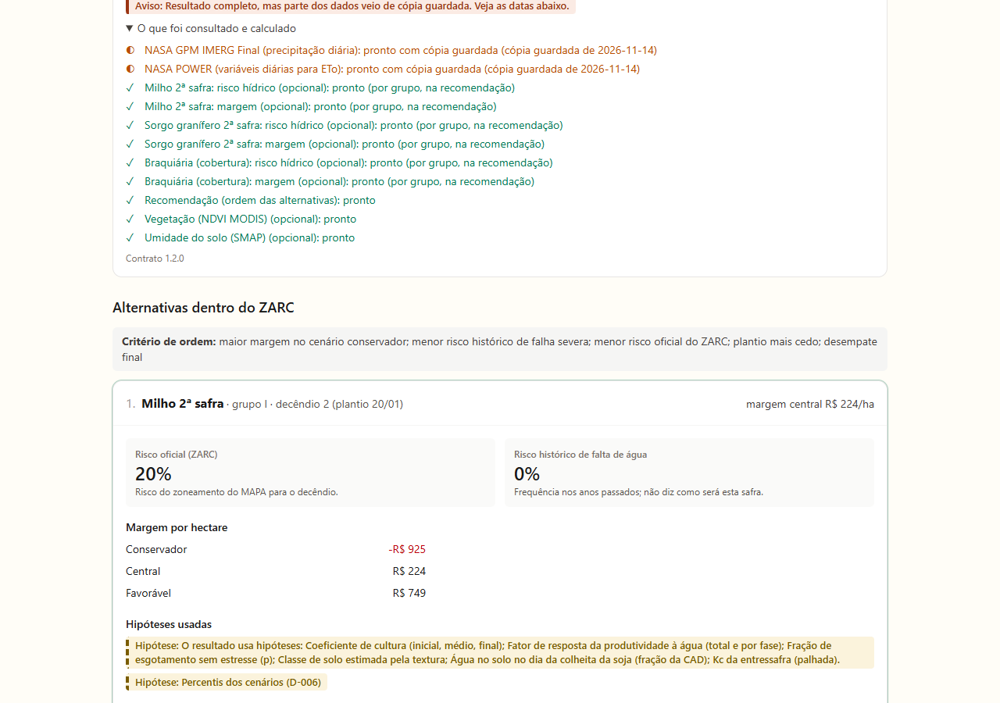

#### Etapa 5: contexto da regiao

URL: `/comparacao/resultado`

| | Verificação | Esperado | Obtido |
|---|---|---|---|
| ✅ | Contextos opcionais avisam que não entram no cálculo | "não entra no cálculo" | conforme o esperado |
| ✅ | Vegetação e umidade do solo presentes | MODIS e SMAP | conforme o esperado |

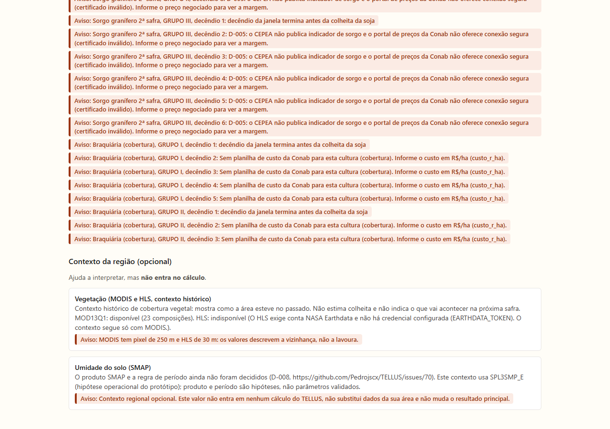

#### Etapa 6: verificações finais

URL: `/comparacao/resultado`

| | Verificação | Esperado | Obtido |
|---|---|---|---|
| ✅ | Nenhum texto trata risco como previsão | sem "vai chover" nem "previsão de" | conforme o esperado |

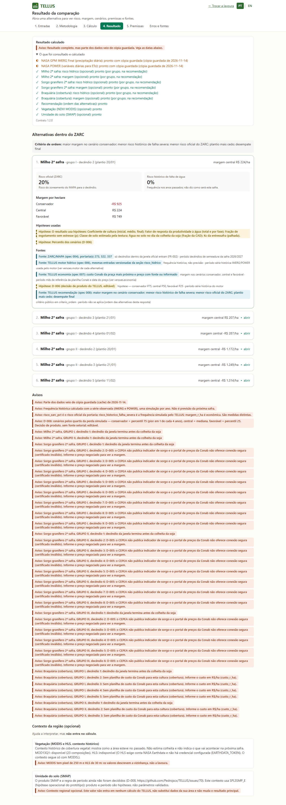

### Grupo "não sei": "O que foi consultado" lista as fontes de clima e as culturas calculadas por grupo

✅ passou · arquivo `frontend/e2e/03-calculo-real.e2e.ts` · tela 1280×900 · 15/11/2026, 16:36:08 → 15/11/2026, 16:36:17

#### Etapa 1: metodologia: comparar as alternativas

URL: `/comparacao/metodologia`

| | Verificação | Esperado | Obtido |
|---|---|---|---|
| ✅ | Busca de município sugere Rio Verde-GO | opção "Rio Verde-GO" na lista | Rio Verde-GO Rio Verde de Mato Grosso-MS Carmo do Rio Verde-GO Conceição do Rio Verde-MG Lucas do Rio Verde-MT São Sebastião do Rio Verde-MG |
| ✅ | Local escolhido aparece no topo do seletor | Rio Verde-GO | Rio Verde-GO  IBGE 5218805 · -17.7397; -51.0378 |
| ✅ | Lavoura guardada para a comparação | lavoura salva no navegador (sessionStorage) | {"tipo":"ponto","lat":-17.73971,"lon":-51.03782,"codigo_ibge":"5218805","municipio":"Rio Verde","uf":"GO","area_ha":null |
| ✅ | Área confirmada a partir da lavoura da tela inicial | estado da área com Rio Verde | Área confirmada: Rio Verde-GO (ponto) |
| ✅ | Entradas válidas levam à metodologia | URL /comparacao/metodologia | http://localhost:4321/comparacao/metodologia |

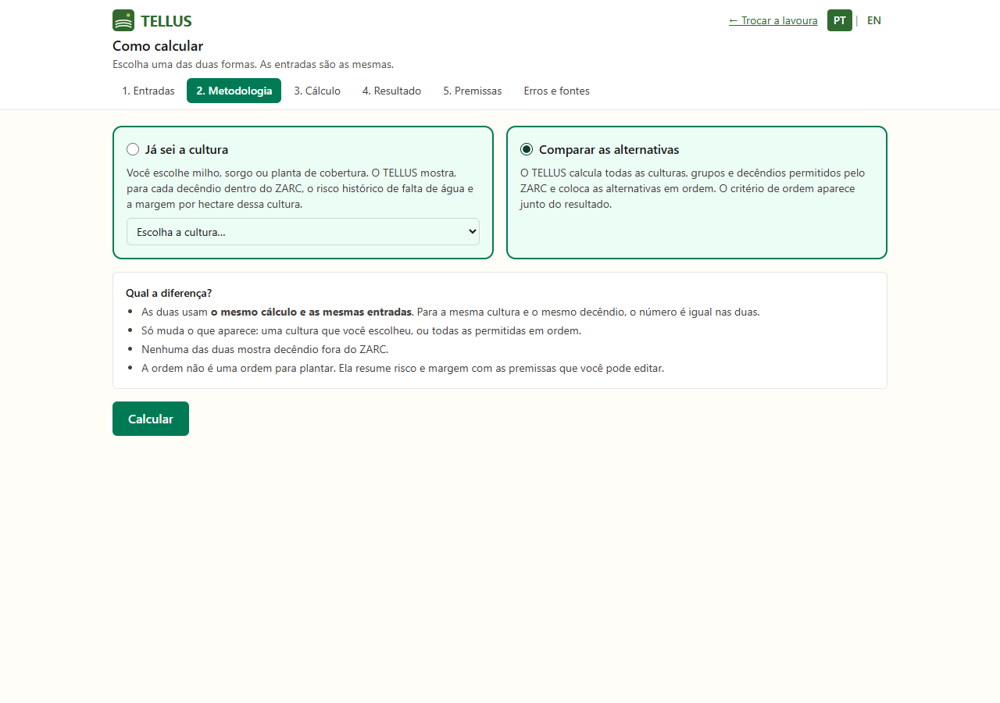

#### Etapa 2: o que foi consultado com grupo nao sei

URL: `/comparacao/resultado`

| | Verificação | Esperado | Obtido |
|---|---|---|---|
| ✅ | Cálculo real termina e mostra o estado do resultado | "Resultado calculado" ou "Resultado parcial" | Resultado calculado |
| ✅ | Fontes de dados listadas | NASA GPM IMERG e NASA POWER entre as etapas | O que foi consultado e calculado ◐ NASA GPM IMERG Final (precipitação diária): pronto com cópia guardada (cópia guardada de 2026-11-14) ◐ NASA POWER (variáveis diárias para ETo): pronto com cópia guardada (cópia guardada de 2026-11-14) ✓ Milho 2ª safra: risco hídrico (opcional): pronto (por grupo, na recomendação) ✓ Milho 2ª safra: margem (opcional): pronto (por grupo, na recomendação) ✓ Sorgo granífero 2ª safra: risco hídrico (opcional): pronto (por grupo, na recomendação) ✓ Sorgo granífero 2ª safra: margem (opcional): pronto (por grupo, na recomendação) ✓ Braquiária (cobertura): risco hídrico (opcional): pronto (por grupo, na recomendação) ✓ Braquiária (cobertura): margem (opcional): pronto (por grupo, na recomendação) ✓ Recomendação (ordem das alternativas): pronto ✓ Vegetação (NDVI MODIS) (opcional): pronto ✓ Umidade do solo (SMAP) (opcional): pronto |
| ✅ | Culturas não aparecem como falha | nenhum "✕" nas culturas | O que foi consultado e calculado ◐ NASA GPM IMERG Final (precipitação diária): pronto com cópia guardada (cópia guardada de 2026-11-14) ◐ NASA POWER (variáveis diárias para ETo): pronto com cópia guardada (cópia guardada de 2026-11-14) ✓ Milho 2ª safra: risco hídrico (opcional): pronto (por grupo, na recomendação) ✓ Milho 2ª safra: margem (opcional): pronto (por grupo, na recomendação) ✓ Sorgo granífero 2ª safra: risco hídrico (opcional): pronto (por grupo, na recomendação) ✓ Sorgo granífero 2ª safra: margem (opcional): pronto (por grupo, na recomendação) ✓ Braquiária (cobertura): risco hídrico (opcional): pronto (por grupo, na recomendação) ✓ Braquiária (cobertura): margem (opcional): pronto (por grupo, na recomendação) ✓ Recomendação (ordem das alternativas): pronto ✓ Vegetação (NDVI MODIS) (opcional): pronto ✓ Umidade do solo (SMAP) (opcional): pronto |
| ✅ | Culturas indicadas como calculadas por grupo | "por grupo, na recomendação" | conforme o esperado |

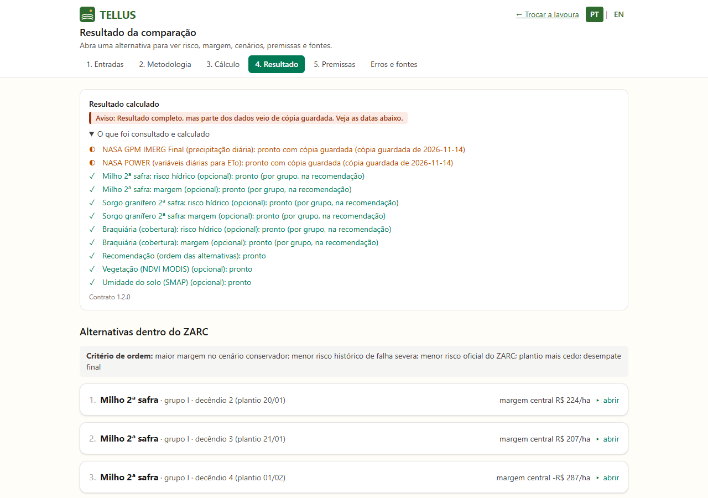

## 4. Premissas editadas e recálculo

### Premissas mostram os padrões reais e a edição chega ao cálculo

✅ passou · arquivo `frontend/e2e/04-premissas.e2e.ts` · tela 1280×900 · 15/11/2026, 16:36:18 → 15/11/2026, 16:36:29

#### Etapa 1: padroes reais de Rio Verde-GO

URL: `/comparacao/premissas`

| | Verificação | Esperado | Obtido |
|---|---|---|---|
| ✅ | Busca de município sugere Rio Verde-GO | opção "Rio Verde-GO" na lista | Rio Verde-GO Rio Verde de Mato Grosso-MS Carmo do Rio Verde-GO Conceição do Rio Verde-MG Lucas do Rio Verde-MT São Sebastião do Rio Verde-MG |
| ✅ | Local escolhido aparece no topo do seletor | Rio Verde-GO | Rio Verde-GO  IBGE 5218805 · -17.7397; -51.0378 |
| ✅ | Lavoura guardada para a comparação | lavoura salva no navegador (sessionStorage) | {"tipo":"ponto","lat":-17.73971,"lon":-51.03782,"codigo_ibge":"5218805","municipio":"Rio Verde","uf":"GO","area_ha":null |
| ✅ | Área confirmada a partir da lavoura da tela inicial | estado da área com Rio Verde | Área confirmada: Rio Verde-GO (ponto) |
| ✅ | Entradas válidas levam à metodologia | URL /comparacao/metodologia | http://localhost:4321/comparacao/metodologia |
| ✅ | Padrões reais carregados para a lavoura | "Padrões reais para Rio Verde-GO" | Padrões reais para Rio Verde-GO. |
| ✅ | Preço do milho com fonte CEPEA | padrão numérico em R$/saca, fonte Cepea/Esalq | 67,34 R$/saca 60 kg · Fonte do padrão: Cepea/Esalq-USP (INDICADOR DO MILHO ESALQ/BM&FBOVESPA), Campinas-SP (região de referência do indicador), cotação de 2026-11-13 |
| ✅ | Custo do milho com fonte Conab | fonte Conab | 5.889 R$/ha · Fonte do padrão: Conab, custo operacional por hectare (Rio Verde-GO-2026) |
| ✅ | Sem faixa de dado de exemplo com padrões reais | faixa oculta | conforme o esperado |

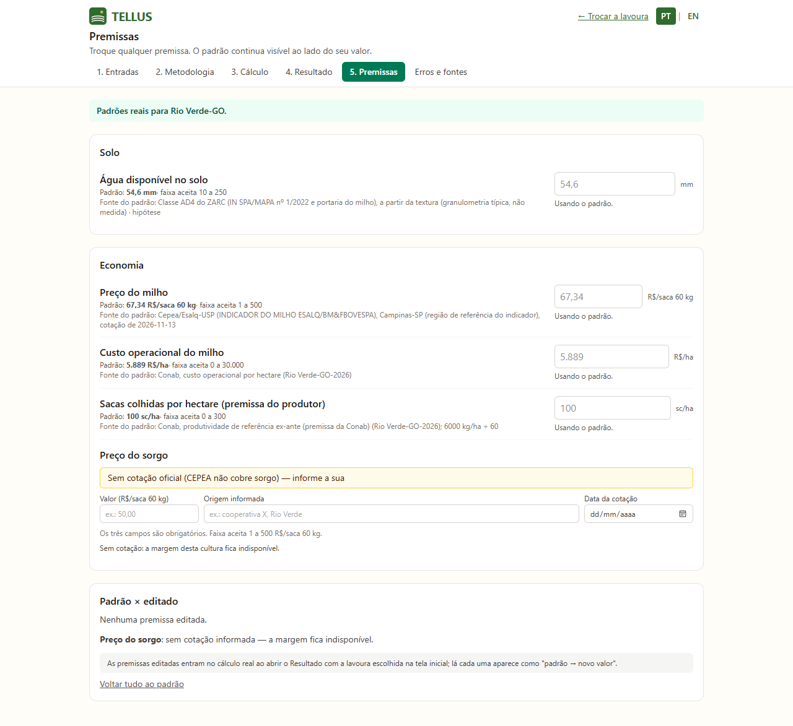

#### Etapa 2: cotacao do sorgo com data futura recusada

URL: `/comparacao/premissas`

| | Verificação | Esperado | Obtido |
|---|---|---|---|
| ✅ | Edição mostra o padrão ao lado do novo valor | "Editado por você (padrão …)" | Editado por você (padrão 67,34 R$/saca 60 kg). |
| ✅ | Cotação com data futura é recusada | erro sobre data no futuro | A data da cotação não pode ser no futuro. |

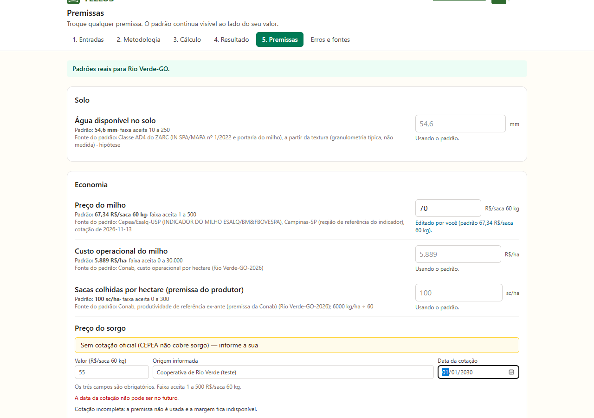

#### Etapa 3: premissas editadas

URL: `/comparacao/premissas`

| | Verificação | Esperado | Obtido |
|---|---|---|---|
| ✅ | Cotação completa aceita | sem erros na cotação | informada pelo produtor 55 R$/saca 60 kg · origem: Cooperativa de Rio Verde (teste) · data: 2026-11-10 |

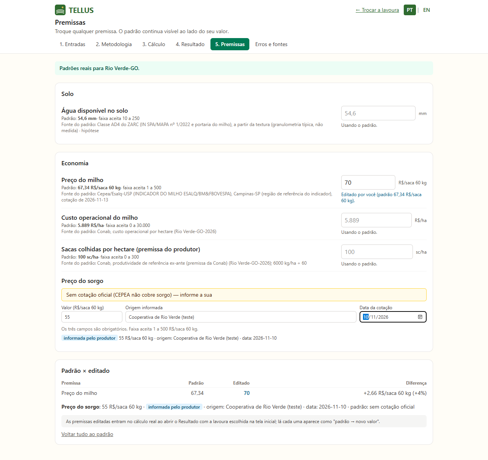

#### Etapa 4: milho com o preco editado

URL: `/comparacao/resultado`

| | Verificação | Esperado | Obtido |
|---|---|---|---|
| ✅ | Cálculo real termina e mostra o estado do resultado | "Resultado calculado" ou "Resultado parcial" | Resultado calculado |
| ✅ | Preço editado chega ao cálculo do milho | hipótese "preco_r_saca (Milho 2ª safra): … → 70 … (editado pelo produtor)" | Hipótese: preco_r_saca (Milho 2ª safra): padrão 67,34 → 70 R$/saca 60 kg (editado pelo produtor) |

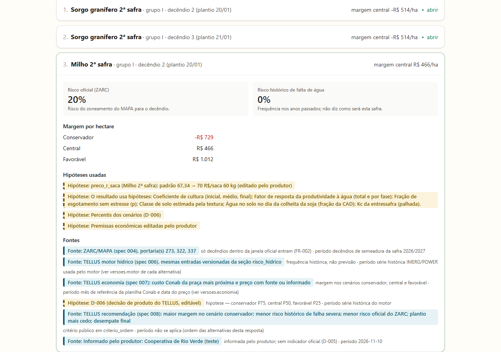

#### Etapa 5: sorgo com a cotacao informada

URL: `/comparacao/resultado`

| | Verificação | Esperado | Obtido |
|---|---|---|---|
| ✅ | Sorgo entra com a cotação informada | alternativa de sorgo com margem | 1.Sorgo granífero 2ª safra · grupo I · decêndio 2 (plantio 20/01) margem central -R$ 514/ha ▸ abrir |
| ✅ | Cotação do sorgo aparece como informada pelo produtor | origem informada no resultado | conforme o esperado |

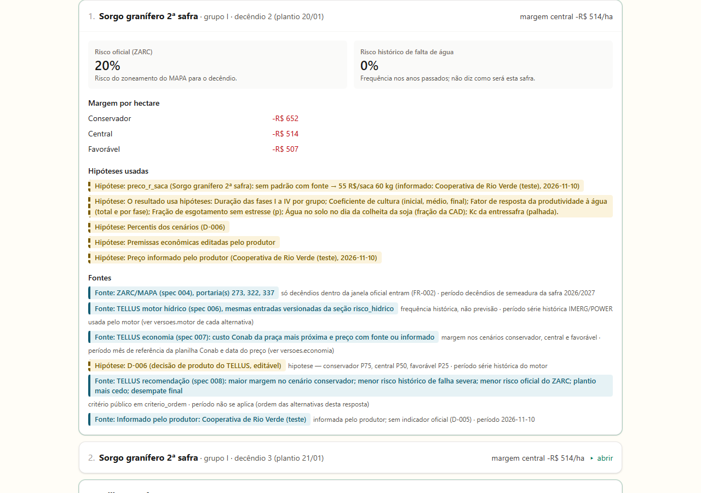

### Grupo "não sei": o resultado mostra o padrão ao lado do preço editado

✅ passou · arquivo `frontend/e2e/04-premissas.e2e.ts` · tela 1280×900 · 15/11/2026, 16:36:29 → 15/11/2026, 16:36:40

#### Etapa 1: padrao ao lado do preco editado

URL: `/comparacao/resultado`

| | Verificação | Esperado | Obtido |
|---|---|---|---|
| ✅ | Busca de município sugere Rio Verde-GO | opção "Rio Verde-GO" na lista | Rio Verde-GO Rio Verde de Mato Grosso-MS Carmo do Rio Verde-GO Conceição do Rio Verde-MG Lucas do Rio Verde-MT São Sebastião do Rio Verde-MG |
| ✅ | Local escolhido aparece no topo do seletor | Rio Verde-GO | Rio Verde-GO  IBGE 5218805 · -17.7397; -51.0378 |
| ✅ | Lavoura guardada para a comparação | lavoura salva no navegador (sessionStorage) | {"tipo":"ponto","lat":-17.73971,"lon":-51.03782,"codigo_ibge":"5218805","municipio":"Rio Verde","uf":"GO","area_ha":null |
| ✅ | Área confirmada a partir da lavoura da tela inicial | estado da área com Rio Verde | Área confirmada: Rio Verde-GO (ponto) |
| ✅ | Entradas válidas levam à metodologia | URL /comparacao/metodologia | http://localhost:4321/comparacao/metodologia |
| ✅ | Cálculo real termina e mostra o estado do resultado | "Resultado calculado" ou "Resultado parcial" | Resultado calculado |
| ✅ | Padrão aparece ao lado do novo valor | "padrão 67,34 → 70" (ou o padrão vigente) | Hipótese: preco_r_saca (Milho 2ª safra): padrão 67,34 → 70 R$/saca 60 kg (editado pelo produtor) |

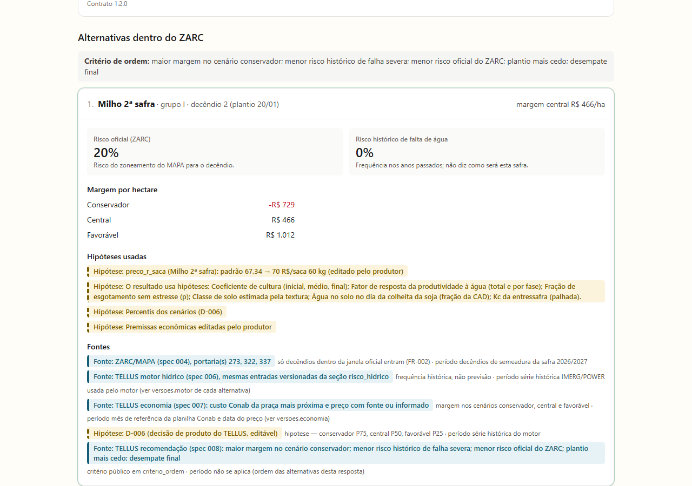

## 5. Versão em inglês (spec 014)

### Trocar para inglês no topo vale em todas as telas e no resultado real

✅ passou · arquivo `frontend/e2e/05-idioma.e2e.ts` · tela 1280×900 · 15/11/2026, 16:36:40 → 15/11/2026, 16:36:46

#### Etapa 1: tela inicial em ingles

URL: `/`

| | Verificação | Esperado | Obtido |
|---|---|---|---|
| ✅ | Página em inglês | lang=en e "Where is your field?" | conforme o esperado |
| ✅ | EN marcado no seletor | aria-pressed=true no EN | conforme o esperado |

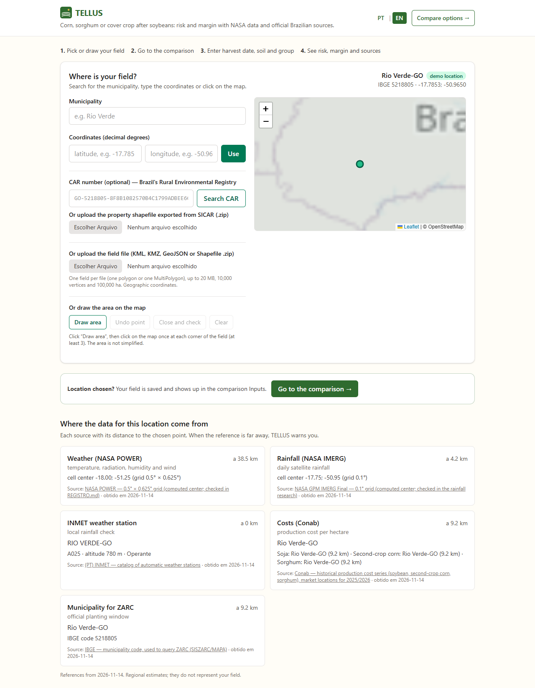

#### Etapa 2: entradas em ingles

URL: `/comparacao/entradas`

| | Verificação | Esperado | Obtido |
|---|---|---|---|
| ✅ | Idioma continua ao trocar de tela | Entradas em inglês ("Field data") | conforme o esperado |

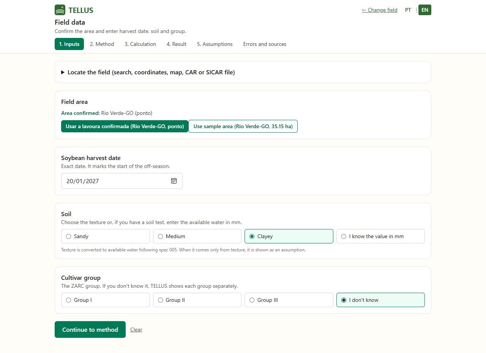

#### Etapa 3: metodologia em ingles

URL: `/comparacao/metodologia`

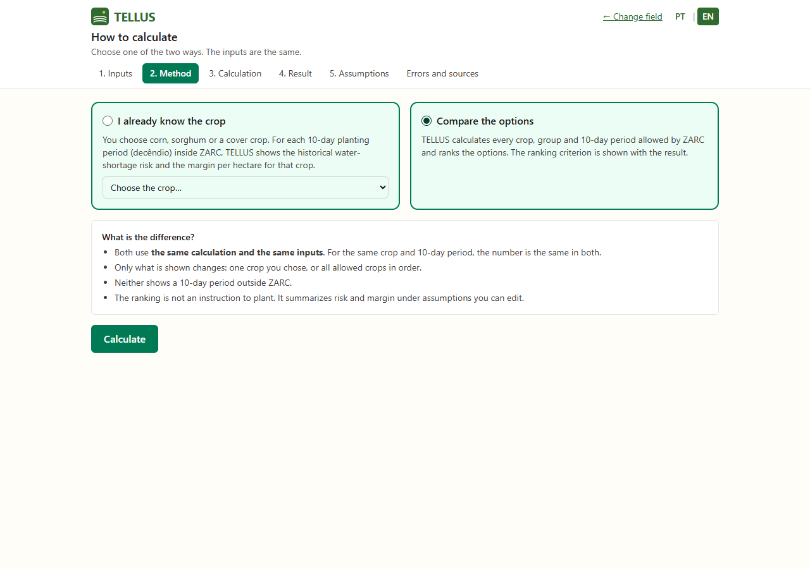

#### Etapa 4: resultado real em ingles

URL: `/comparacao/resultado`

| | Verificação | Esperado | Obtido |
|---|---|---|---|
| ✅ | Cálculo real termina e mostra o estado do resultado | "Resultado calculado" ou "Resultado parcial" | Result calculated |
| ✅ | Resultado real em inglês | "Options inside ZARC" e critério em inglês | conforme o esperado |
| ✅ | Nenhuma mensagem do backend sem tradução | nenhum "(PT)" | conforme o esperado |
| ✅ | Sem palavras portuguesas no resultado visível | nenhuma das palavras: não, com, sem, para, safra, margem… | nenhuma |
| ✅ | Riscos e cenários em inglês | Official risk (ZARC), Conservative/Central/Favorable | conforme o esperado |

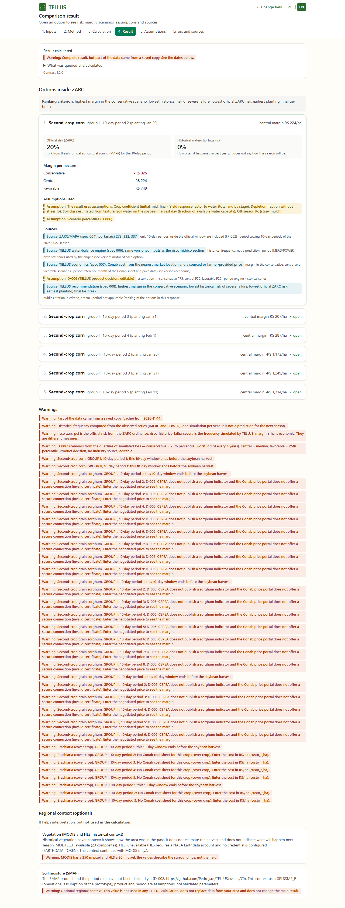

#### Etapa 5: de volta ao portugues

URL: `/comparacao/resultado`

| | Verificação | Esperado | Obtido |
|---|---|---|---|
| ✅ | Cálculo real termina e mostra o estado do resultado | "Resultado calculado" ou "Resultado parcial" | Resultado calculado |
| ✅ | Voltar para PT recalcula em português | lang=pt-BR e "Alternativas dentro do ZARC" | conforme o esperado |

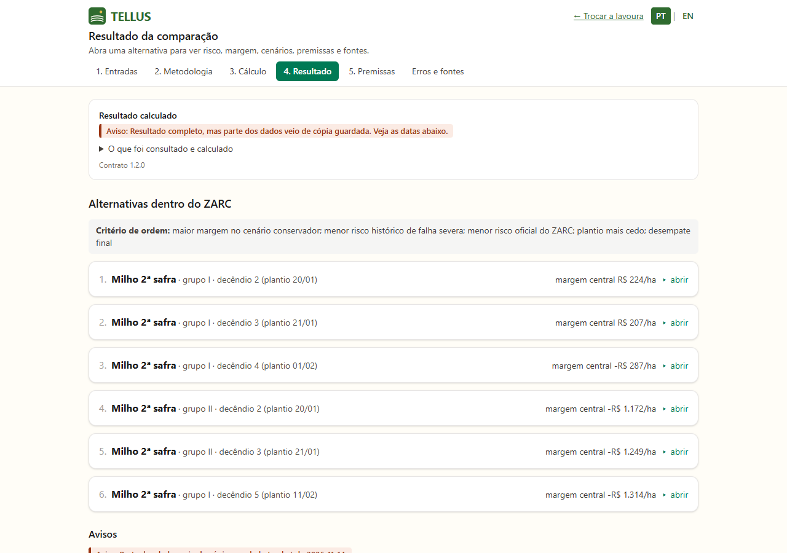

### Link com ?lang=en abre direto em inglês

✅ passou · arquivo `frontend/e2e/05-idioma.e2e.ts` · tela 1280×900 · 15/11/2026, 16:36:46 → 15/11/2026, 16:36:47

#### Etapa 1: link com lang en

URL: `/comparacao/metodologia?lang=en`

| | Verificação | Esperado | Obtido |
|---|---|---|---|
| ✅ | Metodologia em inglês pelo link | "How to calculate" | conforme o esperado |

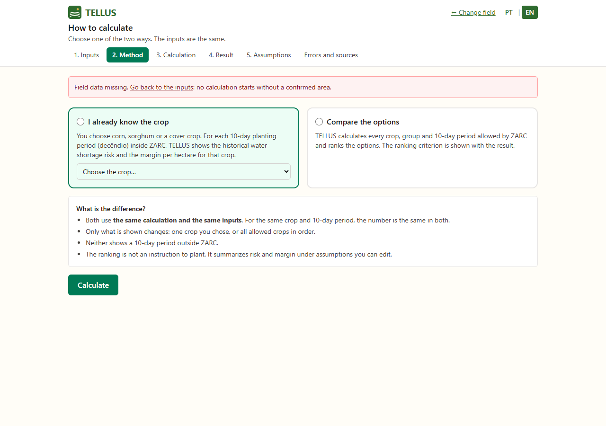

## 6. Celular (390 × 844)

### Fluxo completo no celular sem nada cortado na lateral

✅ passou · arquivo `frontend/e2e/06-celular.e2e.ts` · tela 390×844 · 15/11/2026, 16:36:47 → 15/11/2026, 16:36:51

#### Etapa 1: tela inicial no celular

URL: `/`

| | Verificação | Esperado | Obtido |
|---|---|---|---|
| ✅ | Tela inicial cabe na largura | sem rolagem lateral | 390px de conteúdo em 390px de tela |

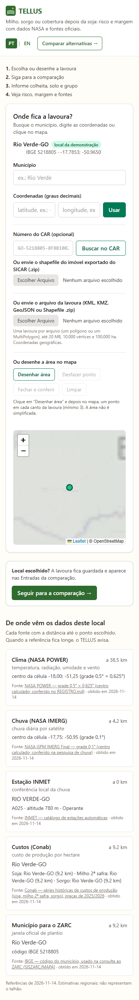

#### Etapa 2: metodologia no celular

URL: `/comparacao/metodologia`

| | Verificação | Esperado | Obtido |
|---|---|---|---|
| ✅ | Busca de município sugere Rio Verde-GO | opção "Rio Verde-GO" na lista | Rio Verde-GO Rio Verde de Mato Grosso-MS Carmo do Rio Verde-GO Conceição do Rio Verde-MG Lucas do Rio Verde-MT São Sebastião do Rio Verde-MG |
| ✅ | Local escolhido aparece no topo do seletor | Rio Verde-GO | Rio Verde-GO  IBGE 5218805 · -17.7397; -51.0378 |
| ✅ | Lavoura guardada para a comparação | lavoura salva no navegador (sessionStorage) | {"tipo":"ponto","lat":-17.73971,"lon":-51.03782,"codigo_ibge":"5218805","municipio":"Rio Verde","uf":"GO","area_ha":null |
| ✅ | Área confirmada a partir da lavoura da tela inicial | estado da área com Rio Verde | Área confirmada: Rio Verde-GO (ponto) |
| ✅ | Entradas válidas levam à metodologia | URL /comparacao/metodologia | http://localhost:4321/comparacao/metodologia |
| ✅ | Metodologia cabe na largura | sem rolagem lateral | 390px de conteúdo em 390px de tela |
| ✅ | Menu de etapas quebra linha | menu inteiro dentro da tela | conforme o esperado |

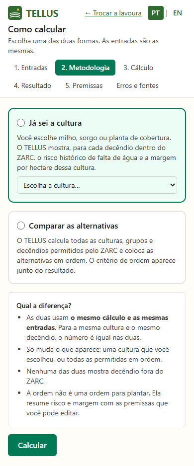

#### Etapa 3: metodologia: comparar as alternativas

URL: `/comparacao/metodologia`

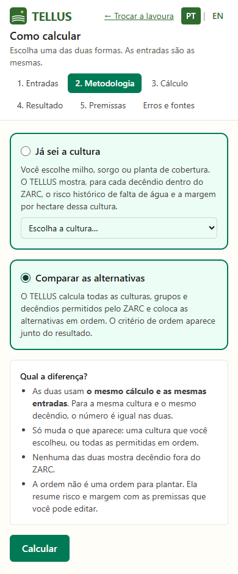

#### Etapa 4: resultado no celular

URL: `/comparacao/resultado`

| | Verificação | Esperado | Obtido |
|---|---|---|---|
| ✅ | Cálculo real termina e mostra o estado do resultado | "Resultado calculado" ou "Resultado parcial" | Resultado calculado |
| ✅ | Resultado cabe na largura | sem rolagem lateral | 390px de conteúdo em 390px de tela |
| ✅ | Alternativa abre com toque | riscos visíveis | conforme o esperado |

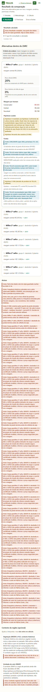

## 7. Telas de erro simuladas

### Tela de cálculo simula sucesso, fonte com cópia guardada e falha sem cópia

✅ passou · arquivo `frontend/e2e/07-erros-simulados.e2e.ts` · tela 1280×900 · 15/11/2026, 16:36:51 → 15/11/2026, 16:36:58

#### Etapa 1: simulacao tudo certo

URL: `/comparacao/carga`

| | Verificação | Esperado | Obtido |
|---|---|---|---|
| ✅ | Tela de simulação marcada como exemplo | faixa "DADO DE EXEMPLO" | conforme o esperado |
| ✅ | Simular: tudo certo: estado legível | /Resultado completo\|Ver resultado/ | conforme o esperado |

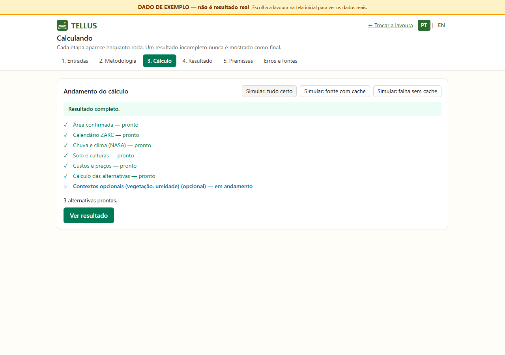

#### Etapa 2: simulacao fonte com cache

URL: `/comparacao/carga`

| | Verificação | Esperado | Obtido |
|---|---|---|---|
| ✅ | Simular: fonte com cache: estado legível | /cópia guardada\|cache/ | conforme o esperado |

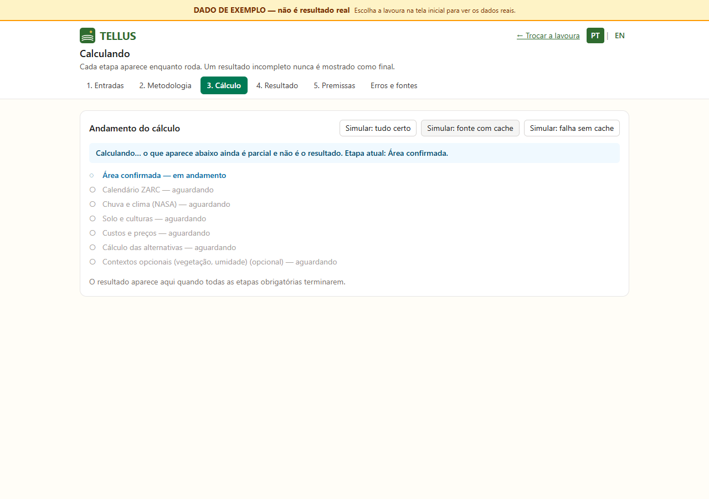

#### Etapa 3: simulacao falha sem cache

URL: `/comparacao/carga`

| | Verificação | Esperado | Obtido |
|---|---|---|---|
| ✅ | Simular: falha sem cache: estado legível | /sem cópia guardada\|Não foi possível/ | conforme o esperado |

#### Etapa 4: verificações finais

URL: `/comparacao/carga`

| | Verificação | Esperado | Obtido |
|---|---|---|---|
| ✅ | Falha sem cache não mostra resultado como final | nenhum "Resultado completo." após a falha | conforme o esperado |

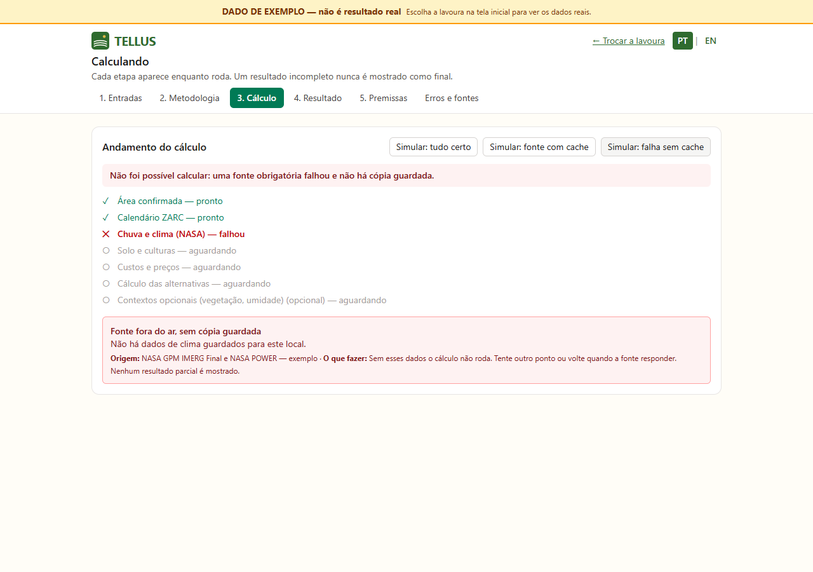

### Tela de erros mostra os três estados de uma fonte

✅ passou · arquivo `frontend/e2e/07-erros-simulados.e2e.ts` · tela 1280×900 · 15/11/2026, 16:36:58 → 15/11/2026, 16:36:58

#### Etapa 1: tres estados de uma fonte

URL: `/comparacao/erros`

| | Verificação | Esperado | Obtido |
|---|---|---|---|
| ✅ | Estado "Fonte respondeu" | Fonte respondeu | conforme o esperado |
| ✅ | Estado "Fonte fora do ar, com cópia guardada" | Fonte fora do ar, com cópia guardada | conforme o esperado |
| ✅ | Estado "Fonte fora do ar, sem cópia guardada" | Fonte fora do ar, sem cópia guardada | conforme o esperado |
| ✅ | Erro diz o que fazer | "O que fazer" | conforme o esperado |

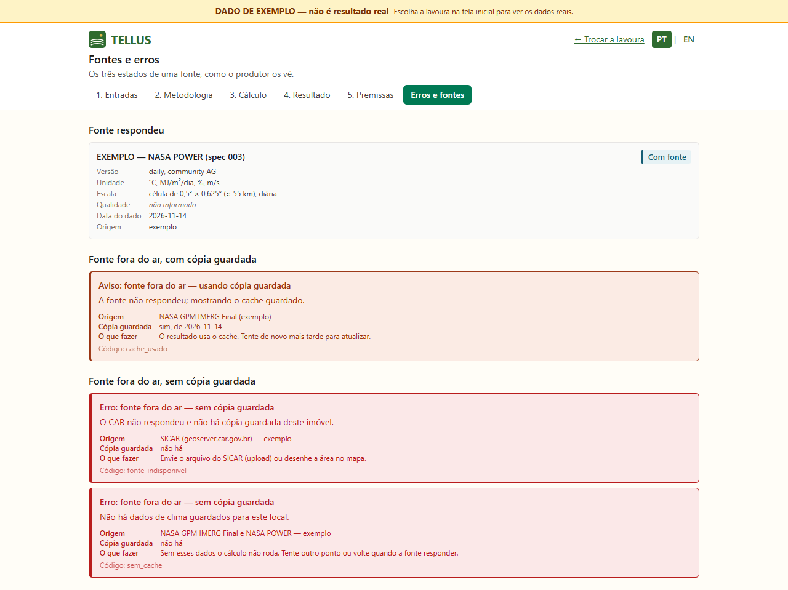

## 8. API do contrato

### Mesmo pedido em PT e EN dá os mesmos números, ordem e hash

✅ passou · arquivo `frontend/e2e/08-api.e2e.ts` · tela 1280×900 · 15/11/2026, 16:36:58 → 15/11/2026, 16:37:01

#### Etapa 1: pt e en com os mesmos numeros

URL: `about:blank`

| | Verificação | Esperado | Obtido |
|---|---|---|---|
| ✅ | As duas respostas com HTTP 200 | 200 e 200 | 200 e 200 |
| ✅ | Idioma declarado na resposta | pt-BR e en | pt-BR e en |
| ✅ | Mesmo hash do pedido | 6c24e1c2231a175e | 6c24e1c2231a175e |
| ✅ | Mesma ordem de alternativas | sorgo_granifero_2a_safra GRUPO I d2 · sorgo_granifero_2a_safra GRUPO I d3 · milho_2a_safra GRUPO I d2 … | sorgo_granifero_2a_safra GRUPO I d2 · sorgo_granifero_2a_safra GRUPO I d3 · milho_2a_safra GRUPO I d2 … |
| ✅ | Tudo o que não é texto é idêntico (números, códigos, estados) | igual | conforme o esperado |
| ✅ | Nenhuma mensagem sem tradução no inglês | 0 ocorrências de "(PT)" | 0 ocorrências |

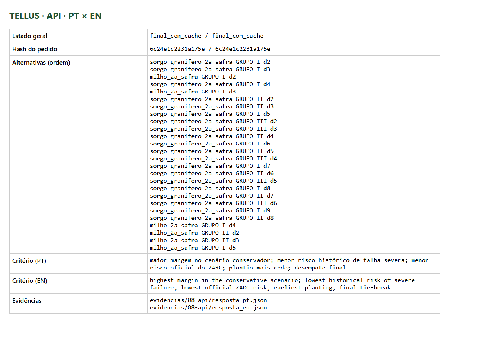

### Versões do contrato: 1.1.0 aceita, 2.0.0 recusada com as versões aceitas

✅ passou · arquivo `frontend/e2e/08-api.e2e.ts` · tela 1280×900 · 15/11/2026, 16:37:01 → 15/11/2026, 16:37:01

#### Etapa 1: versoes do contrato

URL: `about:blank`

| | Verificação | Esperado | Obtido |
|---|---|---|---|
| ✅ | Servidor fala o contrato 1.2.0 | 1.2.0 | 1.2.0 |
| ✅ | Pedido 1.1.0 continua aceito | HTTP 200 | HTTP 200 |
| ✅ | Pedido 2.0.0 recusado com código | HTTP 422, versao_incompativel | HTTP 422, versao_incompativel |

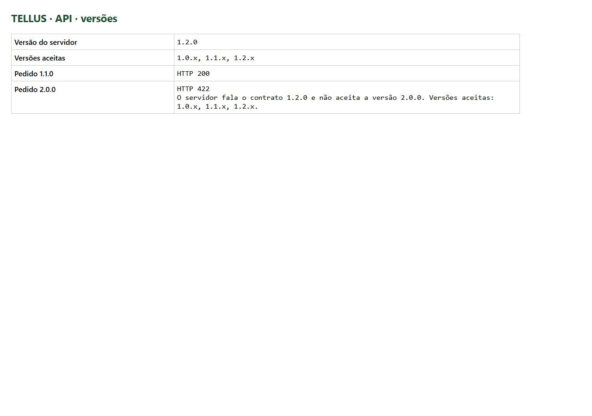

### Pedido sem área confirmada não começa o cálculo

✅ passou · arquivo `frontend/e2e/08-api.e2e.ts` · tela 1280×900 · 15/11/2026, 16:37:01 → 15/11/2026, 16:37:01

#### Etapa 1: area nao confirmada recusada

URL: `about:blank`

| | Verificação | Esperado | Obtido |
|---|---|---|---|
| ✅ | Recusado antes do cálculo | HTTP 422, pedido_invalido, campo area | HTTP 422, pedido_invalido: Pedido inválido: area: a área precisa estar confirmada pelo produtor antes do cálculo |

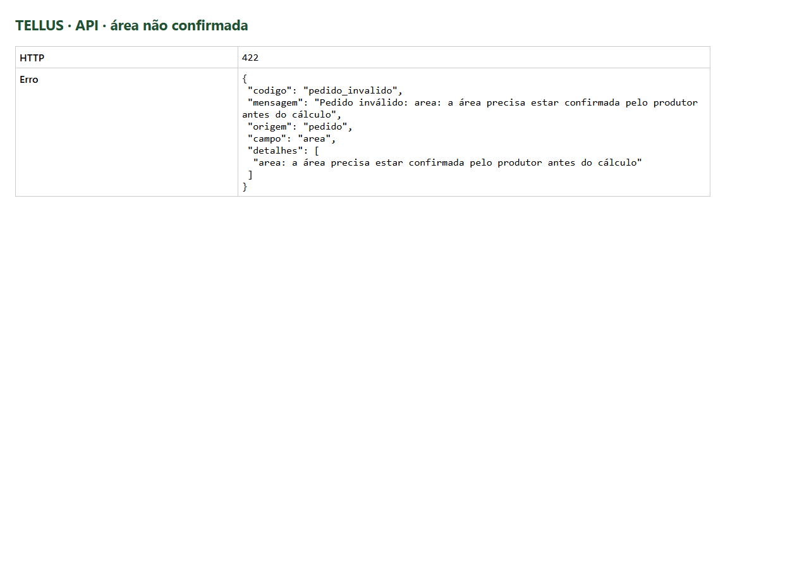
